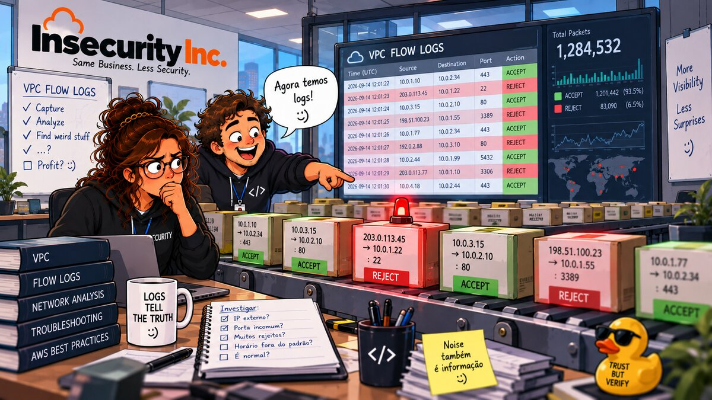

# 10 — 🌊 VPC Flow Logs



**Arco:** Rede  
**Conceito:** Visibilidade de tráfego  
**Well-Architected:** [SEC04-BP01](https://docs.aws.amazon.com/wellarchitected/latest/security-pillar/sec_detect_investigate_events_app_service_logging.html)  
**Custo:** 🟢

## 🎬 Cenário

O capítulo 09 corrigiu *quem* pode falar com quem: web, app e banco, cada um com seu security group, sem porta 22 aberta para o mundo. Na retrospectiva do incidente — a regra "só até resolver o acesso" que ficou pendurada por semanas —, alguém do time de segurança faz a pergunta óbvia: **"tá, mas naquelas semanas, alguém tentou entrar pela 22? Escanearam a porta? Chegaram a conectar?"**

Silêncio. Ninguém sabe. E não é que a resposta seja difícil de achar — é que **não existe onde procurar**. Nenhuma VPC da Insecurity Inc. jamais teve VPC Flow Logs habilitado, nem a do laboratório do capítulo 09, nem a VPC padrão da conta, que existe desde o primeiro dia. Conferido nesta conta, antes de qualquer coisa deste capítulo:

```bash
aws ec2 describe-flow-logs --query 'length(FlowLogs)' --output text
# 0 -- nenhum flow log jamais existiu

DEFAULT_VPC=$(aws ec2 describe-vpcs --filters Name=is-default,Values=true --query 'Vpcs[0].VpcId' --output text)
aws ec2 describe-flow-logs --filter Name=resource-id,Values="$DEFAULT_VPC" --query 'length(FlowLogs)' --output text
# 0 -- nem a VPC padrão, a que já existia antes de qualquer laboratório
```

Um security group *bloqueia* silenciosamente qualquer coisa fora das suas regras: descarta o pacote e segue a vida, sem RST, sem ICMP de destino inalcançável, sem nada. É assim que um firewall stateful funciona — e é o comportamento correto. O problema é que, sem Flow Logs, esse silêncio também não deixa rastro em **nenhum outro lugar**. Mesmo que a porta 22 tivesse sido escaneada mil vezes enquanto esteve aberta, ninguém teria como saber, nem hoje, nem daqui a um ano.

O fundador, quando perguntado, resume o raciocínio da empresa até aqui: *"a gente sempre pensou em bloquear. Nunca pensou em ver."*

## 🚨 O Problema

1. **Nenhuma VPC nasce com Flow Logs habilitado.** Diferente do CloudTrail, que já grava 90 dias de eventos de gerenciamento sem nenhuma configuração, o Flow Logs é 100% *opt-in*, recurso a recurso — uma VPC, uma subnet ou uma interface de rede por vez. Ninguém "esqueceu" de ligar; a AWS nunca liga sozinha.
2. **Um bloqueio de security group não deixa rastro em lugar nenhum.** Testado neste próprio capítulo (teste opcional, adiante): uma tentativa de conexão TCP numa porta fechada simplesmente trava até o timeout do lado de quem tentou — nada volta, nem para o atacante, nem para ninguém. Sem Flow Logs, **"ninguém tentou"** e **"alguém tentou e foi barrado"** são, na prática, indistinguíveis: os dois cenários produzem exatamente zero evidência.
3. **Passar no mínimo de conformidade não é ter visibilidade.** O Security Hub CSPM audita isso com o controle **[EC2.6] VPC flow logging should be enabled in all VPCs** — CIS AWS Foundations Benchmark **v5.0.0 e v3.0.0, requisito 3.7** (v1.4.0, 3.9; v1.2.0, 2.9) —, por trás da regra gerenciada do Config `vpc-flow-logs-enabled`. Só que a checagem automatizada do Security Hub fixa o parâmetro `trafficType` em **REJECT**: o suficiente para "diagnosticar regras restritivas demais" (a frase é da própria documentação da AWS), mas mudo para a outra metade da pergunta do Cenário — **algo que não devia ter passado, passou mesmo assim?** Só um flow log com ACCEPT (ou `ALL`, que contém os dois) responde isso. Uma conta pode ficar 100% verde no EC2.6 só com REJECT e continuar cega para tudo que foi aceito.
4. **"Religar tudo" tem um custo escondido, e a AWS não avisa.** Nada impede criar o mesmo flow log duas vezes sobre o mesmo recurso — testado nesta conta: um segundo flow log (`REJECT`, publicando no mesmo log group) foi criado sobre uma VPC que já tinha um (`ALL`) ativo, sem aviso, sem erro, sem deduplicação:

   ```text
   -------------------------------------
   |         DescribeFlowLogs         |
   +-----------------------+----------+
   |  fl-0a08922834e3afeca |  ALL     |
   |  fl-02084e63ecdfd89fd |  REJECT  |
   +-----------------------+----------+
   ```

   A AWS permite até 250 assinaturas de flow log por recurso. Dois flow logs cobrindo o mesmo tráfego é o dobro do custo de ingestão, por engano, sem nenhum sinal de que há redundância — a linha "cadeados: 09" desta empresa se repete aqui como "logs: 2x".
5. **A política de referência da própria AWS é ampla demais.** A documentação oficial do papel IAM do flow log mostra, como exemplo mínimo, uma política com `"Resource": "*"` — qualquer log group da conta, de qualquer serviço, não só o deste capítulo. É o oposto do que o capítulo 01 (least privilege) defende, num lugar em que pouca gente pensa em conferir.
6. **Flow Logs não vê tudo — e "não capturado" não é o mesmo que "aceito".** A documentação lista, entre outros, o tráfego para o resolvedor DNS da Amazon, para `169.254.169.254` (IMDS) e `169.254.169.123` (sincronismo de horário), DHCP, ARP, tráfego espelhado (*Traffic Mirroring*) na origem, e o tráfego entre uma interface de VPC endpoint e um Network Load Balancer. Quem trata Flow Logs como "o log de tudo que passou pela rede" carrega pontos cegos sistemáticos que nenhum dashboard aponta — ver Dívidas em aberto.

## ✅ A Correção

1. **VPC dedicada**, mesmo raciocínio do capítulo 09 — mas com uma diferença: aqui a subnet é **pública** (internet gateway + rota `0.0.0.0/0`). Não é para o `terraform apply` em si, que sozinho não cria nenhuma instância e não gera nenhum tráfego: é o que o **teste opcional** (adiante) precisa para alcançar, da internet, a instância que ele cria e destrói fora do Terraform — mesmo padrão do Reachability Analyzer do capítulo 09.
2. **Flow log em nível de VPC, tráfego `ALL`** — não só `REJECT`. Vai além do mínimo do EC2.6 de propósito: a pergunta do Cenário também precisa da metade `ACCEPT`.
3. **Destino: CloudWatch Logs**, num log group dedicado (`/insecurity-inc/vpc-flow-logs`), retenção de **1 dia** (o laboratório é destruído ao final do teste; a retenção só limita o estrago de alguém esquecer o `destroy`), criptografado em repouso com a chave gerenciada da AWS — sem CMK própria (ver Dívidas em aberto, e o comentário de custo no `main.tf`).
4. **Formato personalizado**, não o padrão. Junta os 14 campos da versão 2 (o padrão) com identificação de VPC/subnet/instância (versão 3), a direção do fluxo e os dois endereços de **pacote** — `pkt-srcaddr`/`pkt-dstaddr`, versão 5, relevantes atrás de um NAT gateway ou load balancer, onde o endereço da interface não é o endereço de quem originou o tráfego de verdade — e as flags TCP (versão 3). A documentação avisa: depois de criado, um flow log **não pode ser reconfigurado** — nem o papel, nem o formato; a única forma de mudar é apagar e criar outro.
5. **Janela de agregação de 1 minuto** (`max_aggregation_interval = 60`), não os 10 minutos padrão da AWS. Mais registros — mais custo de ingestão, aceitável num laboratório que existe só durante o teste — em troca de os dados aparecerem rápido o suficiente para um teste interativo (na prática, os primeiros registros deste capítulo levaram pouco menos de 3 minutos para aparecer no CloudWatch, abaixo dos "cerca de 5 minutos" que a documentação estima).
6. **Papel IAM dedicado, mais restrito que a referência da AWS:**
   - a condição `aws:SourceAccount` + `aws:SourceArn` contra o *[confused deputy](https://docs.aws.amazon.com/IAM/latest/UserGuide/confused-deputy.html)*, que a política de exemplo da documentação **não tem**;
   - sem `logs:CreateLogGroup` (o Terraform já é dono do ciclo de vida do grupo) e com o `Resource` travado num log group só, em vez do `"*"` do exemplo oficial — o mesmo espírito de menor privilégio do capítulo 01.

   Pegadinha real, descoberta testando nesta conta durante a escrita deste capítulo: o atributo `arn` do recurso `aws_cloudwatch_log_group` no Terraform **não** tem o `:*` final que a API bruta do CloudWatch Logs devolve (`describe-log-groups` mostra `...vpc-flow-logs:*`; o state do Terraform guarda `...vpc-flow-logs`, sem o sufixo). Usar o atributo direto no `Resource` da política deixa o papel sem permissão real sobre os log streams — e ninguém percebe na hora: o `aws_flow_log` é criado do mesmo jeito (a criação não valida a permissão), só a entrega dos registros falharia, em silêncio. O `main.tf` acrescenta o `:*` à mão por isso (passo 4 de Como testar prova a diferença).
7. **Tráfego real só no teste opcional**, criado e destruído inteiramente por CLI — não é um recurso do Terraform. Mesmo padrão do Reachability Analyzer do capítulo 09: mantém o `terraform apply` básico gratuito e sem instância nenhuma, e isola o único gasto real (alguns minutos de `t3.micro`) num bloco autocontido.

**Dívidas em aberto.**

- **S3 como destino alternativo.** Mais barato para retenção longa (sem custo de ingestão do CloudWatch Logs, só armazenamento) e consultável via Athena — a própria SEC04-BP01 recomenda S3 para períodos maiores. Fora do escopo aqui: o CloudWatch Logs Insights, usado no teste opcional, é o que dá a consulta interativa mais rápida para um laboratório.
- **GuardDuty não depende deste Flow Logs.** A documentação da AWS é explícita: o GuardDuty "puxa fluxos de dados independentes diretamente do CloudTrail, VPC Flow Logs, logs de consulta DNS" **por canal próprio**, sem exigir que a conta tenha Flow Logs habilitado — não é este recurso que "liga" a detecção de ameaças de rede da AWS. O que este capítulo entrega é visibilidade e evidência **da própria Insecurity Inc.**, para investigação e para as obrigações de conformidade da SEC04-BP01 — um objetivo diferente, e complementar.
- **Nada alerta sobre um padrão de REJECT.** Um flood de rejeições na mesma porta (o começo de um scan) fica só nos dados, sem gatilho — é assunto do EventBridge, capítulo 13.
- **Sem consulta de longo prazo.** CloudWatch Logs Insights cobre o teste deste capítulo; um SIEM ou Athena sobre S3 para meses de histórico é maturidade operacional além de um laboratório.
- **Os pontos cegos do Problema, ponto 6, continuam existindo** depois deste capítulo — Flow Logs nunca foi, e não vira, "o log de tudo".
- **Retenção de 1 dia é para o laboratório, não para produção.** A SEC04-BP01 cita de três meses a um ano como prática comum, com retenção de até sete anos conforme a obrigação regulatória.

## 🧪 Como aplicar

Três caminhos equivalentes — escolha o que fizer sentido para você.

> **Custo:** o `terraform apply` sozinho não cria nenhuma instância e não gera tráfego algum, então o log group fica praticamente vazio — a cobrança de ingestão do CloudWatch Logs (vended logs: US$0,50/GB nesta região) é uma fração de centavo. O único gasto real é o **teste opcional**: poucos minutos de uma instância `t3.micro` (US$0,0104/hora nesta conta e região) — bem abaixo de um centavo de dólar no total.

### 🏗️ Opção 1 — Terraform (caminho testado neste repo)

```bash
terraform init
terraform apply
```

Testado com Terraform 1.16.1 e provider AWS 5.100.0 (o código pede `>= 1.7` e `~> 5.0`). Cria 10 recursos: VPC, internet gateway, subnet, tabela de rotas, associação de rota, default SG esvaziado, log group, papel IAM, política IAM e o flow log.

### ⌨️ Opção 2 — AWS CLI

```bash
REGION=$(aws configure get region)
ACCOUNT_ID=$(aws sts get-caller-identity --query Account --output text)
AZ=$(aws ec2 describe-availability-zones --query 'AvailabilityZones[0].ZoneName' --output text)
for v in REGION ACCOUNT_ID AZ; do eval "val=\$$v"; [ -n "$val" ] && [ "$val" != None ] || echo "$v VAZIA -- não continue sem corrigir (confira o login AWS e o 'aws configure')"; done

tagspec() { echo "ResourceType=$1,Tags=[{Key=Name,Value=$2},{Key=project,Value=insecurity-inc},{Key=env,Value=lab},{Key=chapter,Value=10}]"; }

# 1. Log group primeiro -- o ARN dele entra na política do papel IAM do passo 2
aws logs create-log-group --log-group-name /insecurity-inc/vpc-flow-logs \
  --tags project=insecurity-inc,env=lab,chapter=10
aws logs put-retention-policy --log-group-name /insecurity-inc/vpc-flow-logs --retention-in-days 1
LOG_GROUP_ARN=$(aws logs describe-log-groups --log-group-name-prefix /insecurity-inc/vpc-flow-logs --query 'logGroups[0].arn' --output text)
[ -n "$LOG_GROUP_ARN" ] && [ "$LOG_GROUP_ARN" != None ] || echo "LOG_GROUP_ARN VAZIA -- não continue sem corrigir (o create-log-group falhou)"
# Aqui o ARN devolvido pela API JÁ vem com ":*" no final -- diferente do
# atributo `arn` do Terraform (ver Correção, ponto 6). Não acrescente outro.

# 2. Papel IAM do flow log -- confused-deputy + Resource travado no log group
TRUST=$(cat <<EOF
{
  "Version": "2012-10-17",
  "Statement": [{
    "Effect": "Allow",
    "Principal": { "Service": "vpc-flow-logs.amazonaws.com" },
    "Action": "sts:AssumeRole",
    "Condition": {
      "StringEquals": { "aws:SourceAccount": "$ACCOUNT_ID" },
      "ArnLike": { "aws:SourceArn": "arn:aws:ec2:$REGION:$ACCOUNT_ID:vpc-flow-log/*" }
    }
  }]
}
EOF
)
ROLE_ARN=$(aws iam create-role --role-name insecurity-inc-vpc-flow-logs \
  --assume-role-policy-document "$TRUST" \
  --tags Key=project,Value=insecurity-inc Key=env,Value=lab Key=chapter,Value=10 \
  --query Role.Arn --output text)
[ -n "$ROLE_ARN" ] && [ "$ROLE_ARN" != None ] || echo "ROLE_ARN VAZIA -- não continue sem corrigir (o create-role falhou)"

PERMISSIONS=$(cat <<EOF
{
  "Version": "2012-10-17",
  "Statement": [{
    "Effect": "Allow",
    "Action": ["logs:CreateLogStream", "logs:PutLogEvents", "logs:DescribeLogGroups", "logs:DescribeLogStreams"],
    "Resource": "$LOG_GROUP_ARN"
  }]
}
EOF
)
aws iam put-role-policy --role-name insecurity-inc-vpc-flow-logs \
  --policy-name insecurity-inc-vpc-flow-logs-publish --policy-document "$PERMISSIONS"

# 3. VPC dedicada, pública (internet gateway + rota 0.0.0.0/0 -- ver Correção, ponto 1)
VPC_ID=$(aws ec2 create-vpc --cidr-block 10.10.0.0/16 \
  --tag-specifications "$(tagspec vpc insecurity-inc-lab)" --query Vpc.VpcId --output text)
aws ec2 modify-vpc-attribute --vpc-id "$VPC_ID" --enable-dns-support
aws ec2 modify-vpc-attribute --vpc-id "$VPC_ID" --enable-dns-hostnames
IGW_ID=$(aws ec2 create-internet-gateway --tag-specifications "$(tagspec internet-gateway insecurity-inc-lab)" --query InternetGateway.InternetGatewayId --output text)
aws ec2 attach-internet-gateway --internet-gateway-id "$IGW_ID" --vpc-id "$VPC_ID"
SUBNET_ID=$(aws ec2 create-subnet --vpc-id "$VPC_ID" --cidr-block 10.10.1.0/24 --availability-zone "$AZ" \
  --tag-specifications "$(tagspec subnet insecurity-inc-lab)" --query Subnet.SubnetId --output text)
aws ec2 modify-subnet-attribute --subnet-id "$SUBNET_ID" --map-public-ip-on-launch
RT_ID=$(aws ec2 create-route-table --vpc-id "$VPC_ID" --tag-specifications "$(tagspec route-table insecurity-inc-lab)" --query RouteTable.RouteTableId --output text)
aws ec2 create-route --route-table-id "$RT_ID" --destination-cidr-block 0.0.0.0/0 --gateway-id "$IGW_ID" > /dev/null
aws ec2 associate-route-table --route-table-id "$RT_ID" --subnet-id "$SUBNET_ID" > /dev/null
for v in VPC_ID IGW_ID SUBNET_ID RT_ID; do eval "val=\$$v"; [ -n "$val" ] && [ "$val" != None ] || echo "$v VAZIA -- não continue sem corrigir"; done

# Default SG esvaziado -- mesmo hábito do capítulo 09
DEFAULT_SG=$(aws ec2 describe-security-groups --filters Name=vpc-id,Values="$VPC_ID" Name=group-name,Values=default --query 'SecurityGroups[0].GroupId' --output text)
DEFAULT_IN=$(aws ec2 describe-security-group-rules --filters Name=group-id,Values="$DEFAULT_SG" --query 'SecurityGroupRules[?IsEgress==`false`].SecurityGroupRuleId' --output text)
DEFAULT_OUT=$(aws ec2 describe-security-group-rules --filters Name=group-id,Values="$DEFAULT_SG" --query 'SecurityGroupRules[?IsEgress==`true`].SecurityGroupRuleId' --output text)
aws ec2 revoke-security-group-ingress --group-id "$DEFAULT_SG" --security-group-rule-ids "$DEFAULT_IN" > /dev/null
aws ec2 revoke-security-group-egress --group-id "$DEFAULT_SG" --security-group-rule-ids "$DEFAULT_OUT" > /dev/null

# 4. O flow log -- ALL, formato personalizado, janela de 1 minuto. Aspas
#    simples no --log-format: impedem o bash de tentar expandir ${...}.
FLOW_LOG_ID=$(aws ec2 create-flow-logs --resource-type VPC --resource-ids "$VPC_ID" \
  --traffic-type ALL --log-destination-type cloud-watch-logs \
  --log-group-name /insecurity-inc/vpc-flow-logs \
  --deliver-logs-permission-arn "$ROLE_ARN" \
  --max-aggregation-interval 60 \
  --log-format '${version} ${account-id} ${interface-id} ${srcaddr} ${dstaddr} ${srcport} ${dstport} ${protocol} ${packets} ${bytes} ${start} ${end} ${action} ${log-status} ${vpc-id} ${subnet-id} ${instance-id} ${type} ${flow-direction} ${pkt-srcaddr} ${pkt-dstaddr} ${tcp-flags}' \
  --tag-specifications "$(tagspec vpc-flow-log insecurity-inc-vpc-flow-log)" \
  --query 'FlowLogIds[0]' --output text)
[ -n "$FLOW_LOG_ID" ] && [ "$FLOW_LOG_ID" != None ] || echo "FLOW_LOG_ID VAZIA -- não continue sem corrigir (confira se ROLE_ARN e LOG_GROUP_ARN estão certos)"
```

### 🖥️ Opção 3 — Console (GUI)

1. **VPC** → **Your VPCs** → **Create VPC** → **VPC only** → **Name tag** `insecurity-inc-lab`, **IPv4 CIDR** `10.10.0.0/16` → tags do capítulo → **Create VPC**. Habilite **DNS resolution** e **DNS hostnames** em **Actions** → **Edit VPC settings**, se não vierem marcados.
2. **Internet gateway:** **VPC** → **Internet gateways** → **Create internet gateway** → nome `insecurity-inc-lab` → **Create** → **Actions** → **Attach to VPC** → a VPC do passo 1.
3. **Subnet:** **VPC** → **Subnets** → **Create subnet** → a VPC do passo 1 → nome `insecurity-inc-lab`, uma zona qualquer, CIDR `10.10.1.0/24` → **Create subnet**. Depois, **Actions** → **Edit subnet settings** → marque **Enable auto-assign public IPv4 address**.
4. **Tabela de rotas:** **VPC** → **Route tables** → **Create route table** → a VPC do passo 1, nome `insecurity-inc-lab` → **Create**. Aba **Routes** → **Edit routes** → **Add route** → destino `0.0.0.0/0`, alvo o internet gateway do passo 2 → **Save**. Aba **Subnet associations** → **Edit subnet associations** → a subnet do passo 3.
5. **Esvaziar o default security group** desta VPC: **EC2** → **Security Groups** → o grupo `default` da VPC do laboratório → remova a única regra de **Inbound rules** e a única de **Outbound rules** (mesmo procedimento do capítulo 09).
6. **Log group:** **CloudWatch** → **Log groups** → **Create log group** → nome `/insecurity-inc/vpc-flow-logs`, **Retention setting** 1 day → tags do capítulo → **Create**.
7. **Papel IAM:** **IAM** → **Roles** → **Create role** → **Custom trust policy** → cole o JSON de confiança do passo 2 da Opção 2 (com `$ACCOUNT_ID` e `$REGION` preenchidos à mão) → **Next** → **Create policy** (aba nova) → **JSON** → cole a política de permissões do mesmo passo (com o ARN do log group do passo 6, terminado em `:*`) → nomeie e crie → volte à criação do papel, anexe essa política → nome do papel `insecurity-inc-vpc-flow-logs` → **Create role**.
8. **O flow log:** **VPC** → **Your VPCs** → selecione a VPC do laboratório → aba **Flow logs** → **Create flow log** → **Filter**: `All` → **Maximum aggregation interval**: `1 minute` → **Destination**: `Send to CloudWatch Logs` → o log group do passo 6 → **IAM role**: o papel do passo 7 → **Log record format**: `Custom format` → marque os campos: `version`, `account-id`, `interface-id`, `srcaddr`, `dstaddr`, `srcport`, `dstport`, `protocol`, `packets`, `bytes`, `start`, `end`, `action`, `log-status`, `vpc-id`, `subnet-id`, `instance-id`, `type`, `flow-direction`, `pkt-srcaddr`, `pkt-dstaddr`, `tcp-flags` (nesta ordem) → tags do capítulo → **Create flow log**.

## 🧾 Como testar

O `terraform apply` básico não cria nenhuma instância e não gera tráfego real — então, sozinho, o log group fica vazio (esperado: "Flow logs do not capture real-time log streams", e sem interface de rede alguma na VPC não há nem sequer registros `NODATA`, que são por interface). Os passos 0 a 4 provam **configuração**: o flow log existe com as opções certas, o papel IAM tem as permissões certas, e dois problemas do Cenário/Problema (registro duplicado e a pegadinha do ARN) são reproduzidos ao vivo. O teste opcional, ao final, prova **tráfego de verdade**.

Requer `jq` e o Terraform, e deve rodar **dentro da pasta do capítulo**.

```bash
VPC_ID=$(terraform output -raw vpc_id)
FLOW_LOG_ID=$(terraform output -raw flow_log_id)
LOG_GROUP=$(terraform output -raw log_group_name)
ROLE_ARN=$(terraform output -raw flow_logs_role_arn)

# Guardrail: sem ele, rodar fora da pasta do capítulo passa em branco.
for v in VPC_ID FLOW_LOG_ID LOG_GROUP ROLE_ARN; do eval "val=\$$v"; [ -n "$val" ] && [ "$val" != None ] || echo "$v VAZIA -- não continue sem corrigir (rode dentro da pasta do capítulo e confira o login AWS)"; done

# 0. Pré-condição: sem deriva.
terraform plan -detailed-exitcode > /dev/null; echo "plan exit=$?  (0 = sem deriva)"

# 1. Inventário: o flow log tem exatamente a configuração que o Correção descreve.
aws ec2 describe-flow-logs --filter Name=resource-id,Values="$VPC_ID" --query 'FlowLogs[0].{Trafego:TrafficType,Destino:LogDestinationType,Janela:MaxAggregationInterval,Status:FlowLogStatus,Papel:DeliverLogsPermissionArn}' --output table
# Esperado: ALL, cloud-watch-logs, 60, ACTIVE, e o ARN do papel deste capítulo.

# 2. O papel IAM: confused-deputy na trust policy, e Resource travado (com ":*") na permissão.
aws iam get-role --role-name insecurity-inc-vpc-flow-logs --query 'Role.AssumeRolePolicyDocument.Statement[0].Condition' --output json
aws iam get-role-policy --role-name insecurity-inc-vpc-flow-logs --policy-name insecurity-inc-vpc-flow-logs-publish --query 'PolicyDocument.Statement[0].Resource' --output text
# Esperado: a condição com aws:SourceAccount e aws:SourceArn; e um Resource
# terminado em ":/insecurity-inc/vpc-flow-logs:*" -- NÃO o "*" da política de
# referência da AWS, e NÃO o ARN sem sufixo (que seria a versão quebrada).

# 3. A pegadinha do ARN, ao vivo: o atributo `arn` do Terraform diverge do que
#    a API bruta devolve para o MESMO log group.
terraform output -raw log_group_arn; echo
aws logs describe-log-groups --log-group-name-prefix "$LOG_GROUP" --query 'logGroups[0].arn' --output text
# Esperado: a primeira linha SEM ":*" no final; a segunda, COM. É por isso que
# o main.tf acrescenta o sufixo à mão na política do papel (passo 2 acima).

# 4. A AWS deixa duplicar um flow log sobre o mesmo recurso, sem avisar --
#    problema 4 do Cenário. (Cria um segundo, temporário, e apaga no fim do passo.)
DUP_ID=$(aws ec2 create-flow-logs --resource-type VPC --resource-ids "$VPC_ID" \
  --traffic-type REJECT --log-destination-type cloud-watch-logs --log-group-name "$LOG_GROUP" \
  --deliver-logs-permission-arn "$ROLE_ARN" \
  --tag-specifications 'ResourceType=vpc-flow-log,Tags=[{Key=teste,Value=nao-faca-isto}]' \
  --query 'FlowLogIds[0]' --output text)
[ -n "$DUP_ID" ] && [ "$DUP_ID" != None ] || echo "DUP_ID VAZIA -- o create-flow-logs falhou; pule para o passo 5"
aws ec2 describe-flow-logs --filter Name=resource-id,Values="$VPC_ID" --query 'FlowLogs[].[FlowLogId,TrafficType]' --output table
# Esperado: DOIS flow logs na mesma VPC, publicando no MESMO log group -- sem
# erro, sem aviso. É o dobro de ingestão cobrada pelo mesmo tráfego.

# REVERT
aws ec2 delete-flow-logs --flow-log-ids "$DUP_ID" --query 'Unsuccessful' --output json
aws ec2 describe-flow-logs --filter Name=resource-id,Values="$VPC_ID" --query 'length(FlowLogs)' --output text
# Esperado: [] e depois 1 -- só o flow log deste capítulo restando.

# 5. Simulação da regra do Config (vpc-flow-logs-enabled) / Security Hub EC2.6
#    -- o Config só chega no capítulo 12, mas a lógica é simples de replicar.
aws ec2 describe-flow-logs --filter Name=resource-id,Values="$VPC_ID" --query "length(FlowLogs[?TrafficType=='ALL' || TrafficType=='REJECT'])" --output text
echo "(>0 = EC2.6 aprovaria esta VPC)"
aws ec2 describe-flow-logs --filter Name=resource-id,Values="$(aws ec2 describe-vpcs --filters Name=is-default,Values=true --query 'Vpcs[0].VpcId' --output text)" --query 'length(FlowLogs)' --output text
echo "(0 = a VPC padrão desta conta reprova EC2.6 hoje -- ver Cenário)"
```

### 🔬 Teste opcional — tráfego real (menos de US$0,01)

Tudo acima prova **configuração**. Este teste gera tráfego de verdade contra uma instância na subnet pública do laboratório e confere, no CloudWatch Logs Insights, se os registros `ACCEPT`/`REJECT` batem com o que a instância realmente recebeu — a única forma de confirmar que a correção do problema 6 (a pegadinha do ARN) realmente resolveu a entrega, e não só a criação do flow log.

> **Custo:** uma instância `t3.micro` por poucos minutos (US$0,0104/hora nesta conta e região) — bem abaixo de um centavo de dólar. A instância e o security group temporário são criados e destruídos inteiramente neste bloco, fora do Terraform (mesmo padrão do Reachability Analyzer no capítulo 09).

```bash
SUBNET_ID=$(terraform output -raw subnet_id)
VPC_ID=$(terraform output -raw vpc_id)
LOG_GROUP=$(terraform output -raw log_group_name)
MY_IP=$(curl -s https://checkip.amazonaws.com)
AMI=$(aws ssm get-parameters --names /aws/service/ami-amazon-linux-latest/al2023-ami-kernel-default-x86_64 --query 'Parameters[0].Value' --output text)
for v in SUBNET_ID VPC_ID LOG_GROUP MY_IP AMI; do eval "val=\$$v"; [ -n "$val" ] && [ "$val" != None ] || echo "$v VAZIA -- não continue sem corrigir (rode dentro da pasta do capítulo, confira o login AWS e a conexão com a internet)"; done

# 1. Security group temporário: só ICMP do seu IP. Nenhuma regra para a porta
#    22 -- é o que vai gerar o REJECT.
TMP_SG=$(aws ec2 create-security-group --group-name insecurity-inc-flowlogs-teste \
  --description "Teste de trafego real do capitulo 10 - so ICMP do meu IP" --vpc-id "$VPC_ID" \
  --tag-specifications 'ResourceType=security-group,Tags=[{Key=project,Value=insecurity-inc},{Key=chapter,Value=10}]' \
  --query GroupId --output text)
[ -n "$TMP_SG" ] && [ "$TMP_SG" != None ] || echo "TMP_SG VAZIA -- não continue sem corrigir"
aws ec2 authorize-security-group-ingress --group-id "$TMP_SG" \
  --ip-permissions "IpProtocol=icmp,FromPort=-1,ToPort=-1,IpRanges=[{CidrIp=$MY_IP/32,Description=ping-de-teste}]" > /dev/null

# 2. Instância descartável, sem par de chaves (não vamos entrar nela por SSH --
#    é exatamente a porta que queremos ver REJEITADA)
INSTANCE_ID=$(aws ec2 run-instances --image-id "$AMI" --instance-type t3.micro \
  --subnet-id "$SUBNET_ID" --security-group-ids "$TMP_SG" --associate-public-ip-address \
  --tag-specifications 'ResourceType=instance,Tags=[{Key=Name,Value=insecurity-inc-flowlogs-teste},{Key=project,Value=insecurity-inc},{Key=chapter,Value=10}]' \
  --query 'Instances[0].InstanceId' --output text)
[ -n "$INSTANCE_ID" ] && [ "$INSTANCE_ID" != None ] || echo "INSTANCE_ID VAZIA -- não continue sem corrigir"
aws ec2 wait instance-running --instance-ids "$INSTANCE_ID"
PUB_IP=$(aws ec2 describe-instances --instance-ids "$INSTANCE_ID" --query 'Reservations[0].Instances[0].PublicIpAddress' --output text)
echo "instancia $INSTANCE_ID em $PUB_IP"

# 3. Gera os dois tipos de registro
ping -c 4 -W 2 "$PUB_IP"                                                  # ACCEPT esperado
timeout 4 bash -c "echo > /dev/tcp/$PUB_IP/22" && echo "conectou (inesperado)" || echo "timeout (esperado -- sem regra para a 22)"

# 4. Espera a entrega (best effort; a documentação estima ~5 min) e consulta
#    o Logs Insights, filtrando pelo seu IP.
#
# Pegadinha real, encontrada testando: o reconhecimento automático de campos
# do Logs Insights para VPC Flow Logs (o que permitiria usar "srcaddr" e
# "dstaddr" direto, sem mais nada) só entra em ação para o FORMATO PADRÃO (14
# campos). Este capítulo usa formato personalizado (22 campos) -- e nesse caso
# "srcaddr"/"dstaddr" não existem como campos prontos: o filtro compara contra
# null, nunca bate, e a query volta vazia SEM erro nenhum (confirmado: a
# consulta com "fields @timestamp, srcaddr, dstaddr, ... | filter srcaddr = 
# ..." roda, dá "status": "Complete" e 0 resultados -- mesmo com os registros
# já entregues e visíveis navegando o log group pela Console). A saída é fazer
# o parsing à mão, na ordem exata do log_format deste capítulo -- os 22
# asteriscos abaixo correspondem, um a um, aos 22 campos do main.tf.
sleep 150
START=$(($(date +%s) - 600)); END=$(date +%s)
QID=$(aws logs start-query --log-group-name "$LOG_GROUP" --start-time "$START" --end-time "$END" \
  --query-string 'parse @message "* * * * * * * * * * * * * * * * * * * * * *" as version, accountId, interfaceId, srcAddr, dstAddr, srcPort, dstPort, protocol, packets, bytes, start, end, action, logStatus, vpcId, subnetId, instanceId, type, flowDirection, pktSrcAddr, pktDstAddr, tcpFlags
| filter srcAddr = "'"$MY_IP"'" or dstAddr = "'"$MY_IP"'"
| sort @timestamp desc
| limit 20' \
  --query 'queryId' --output text)
sleep 5
aws logs get-query-results --query-id "$QID" --output json | jq -r '.results[] | map("\(.field)=\(.value)") | join(" | ")'
# Se vier vazio, espere mais um pouco (o campo "start"/delivery é best effort)
# e repita a consulta -- não é incomum levar mais que os 5 minutos estimados.

# 5. Limpeza -- sempre, mesmo se o passo 4 não achou nada ainda
aws ec2 terminate-instances --instance-ids "$INSTANCE_ID" > /dev/null
aws ec2 wait instance-terminated --instance-ids "$INSTANCE_ID"
aws ec2 delete-security-group --group-id "$TMP_SG"
```

Rodado nesta conta, o primeiro registro (o `REJECT` da porta 22) apareceu em **2 minutos e 47 segundos** — mais rápido que a estimativa da documentação, graças à janela de 1 minuto:

```text
version=5 | accountId=230650392331 | interfaceId=eni-0d9188405a428af3c | srcAddr=168.232.224.136 | dstAddr=10.10.1.135 | srcPort=18637 | dstPort=22 | protocol=6 | packets=4 | bytes=240 | start=1790070570 | end=1790070593 | action=REJECT | logStatus=OK | vpcId=vpc-0d8493bba... | subnetId=subnet-046548d36f... | instanceId=i-0b5410bb4c92d2054 | type=IPv4 | flowDirection=ingress | pktSrcAddr=168.232.224.136 | pktDstAddr=10.10.1.135 | tcpFlags=2
```

`protocol=6` = TCP, `dstPort=22` = a porta sem regra, `tcpFlags=2` = só `SYN` (o pedido de conexão, sozinho — nunca houve resposta). Exatamente o que o `timeout` do passo 3 já indicava, agora com endereço, hora e interface registrados.

O `ping` também confirmou, com um detalhe a mais: registros `ACCEPT` de **ingresso** para tráfego que este capítulo nunca autorizou explicitamente — pacotes UDP na porta 123 (NTP) e TCP na 443, iniciados pela própria instância (o agente do Amazon Linux verificando a hora e chamando a AWS ao subir) e aceitos de volta **porque o security group é *stateful***: a resposta a uma conexão que a instância abriu entra sozinha, sem precisar de regra de entrada — o mesmo princípio que o capítulo 09 documentou para os três security groups do checkout, agora visível nos dados, não só na teoria.

E um bônus não planejado: nos primeiros segundos com IP público, a instância já recebeu tentativas de conexão de origens que nunca foram convidadas — todas `REJECT`, em portas aleatórias, de IPs que não são o do operador do teste. É o ruído de fundo da internet (varredura automatizada) encontrando um IP novo em segundos. Sem Flow Logs, esse tipo de tentativa é exatamente o que fica invisível — é a resposta, ao vivo, para a pergunta do Cenário.

## 🧹 Como destruir

### 🏗️ Terraform

```bash
terraform destroy
```

Testado nesta conta: `Destroy complete! Resources: 10 destroyed.` O Terraform respeita a ordem sozinho (flow log e associação de rota antes do que eles referenciam, VPC por último).

### ⌨️ AWS CLI

```bash
VPC_ID=$(aws ec2 describe-vpcs --filters Name=tag:Name,Values=insecurity-inc-lab Name=tag:chapter,Values=10 --query 'Vpcs[0].VpcId' --output text)
[ -n "$VPC_ID" ] && [ "$VPC_ID" != None ] || echo "VPC_ID VAZIA -- não continue sem corrigir (confira o login AWS; se já apagou tudo, não há mais nada a fazer)"

FLOW_LOG_ID=$(aws ec2 describe-flow-logs --filter Name=resource-id,Values="$VPC_ID" --query 'FlowLogs[0].FlowLogId' --output text)
[ -n "$FLOW_LOG_ID" ] && [ "$FLOW_LOG_ID" != None ] && aws ec2 delete-flow-logs --flow-log-ids "$FLOW_LOG_ID"

aws iam delete-role-policy --role-name insecurity-inc-vpc-flow-logs --policy-name insecurity-inc-vpc-flow-logs-publish
aws iam delete-role --role-name insecurity-inc-vpc-flow-logs
aws logs delete-log-group --log-group-name /insecurity-inc/vpc-flow-logs

IGW_ID=$(aws ec2 describe-internet-gateways --filters Name=attachment.vpc-id,Values="$VPC_ID" --query 'InternetGateways[0].InternetGatewayId' --output text)
[ -n "$IGW_ID" ] && [ "$IGW_ID" != None ] && aws ec2 detach-internet-gateway --internet-gateway-id "$IGW_ID" --vpc-id "$VPC_ID" && aws ec2 delete-internet-gateway --internet-gateway-id "$IGW_ID"

RT_ID=$(aws ec2 describe-route-tables --filters Name=vpc-id,Values="$VPC_ID" Name=tag:Name,Values=insecurity-inc-lab --query 'RouteTables[0].RouteTableId' --output text)
ASSOC_ID=$(aws ec2 describe-route-tables --route-table-ids "$RT_ID" --query 'RouteTables[0].Associations[0].RouteTableAssociationId' --output text 2>/dev/null)
[ -n "$ASSOC_ID" ] && [ "$ASSOC_ID" != None ] && aws ec2 disassociate-route-table --association-id "$ASSOC_ID"
[ -n "$RT_ID" ] && [ "$RT_ID" != None ] && aws ec2 delete-route-table --route-table-id "$RT_ID"

SUBNET_ID=$(aws ec2 describe-subnets --filters Name=vpc-id,Values="$VPC_ID" --query 'Subnets[0].SubnetId' --output text)
[ -n "$SUBNET_ID" ] && [ "$SUBNET_ID" != None ] && aws ec2 delete-subnet --subnet-id "$SUBNET_ID"

aws ec2 delete-vpc --vpc-id "$VPC_ID"
```

### 🖥️ Console (GUI)

1. **VPC** → **Your VPCs** → a VPC `insecurity-inc-lab` → aba **Flow logs** → selecione o flow log → **Actions** → **Delete flow log**.
2. **IAM** → **Roles** → `insecurity-inc-vpc-flow-logs` → remova a política inline (aba **Permissions**) → **Delete**.
3. **CloudWatch** → **Log groups** → `/insecurity-inc/vpc-flow-logs` → **Actions** → **Delete log group(s)**.
4. **VPC** → **Your VPCs** → `insecurity-inc-lab` → **Actions** → **Delete VPC**. O console lista o que vai junto (subnet, tabela de rotas, internet gateway, default security group); confirme.

Depois do destroy (de qualquer um dos três caminhos), confira que não sobrou nada:

```bash
aws ec2 describe-vpcs --filters Name=tag:project,Values=insecurity-inc Name=tag:chapter,Values=10 --query 'Vpcs[].VpcId' --output text
aws ec2 describe-flow-logs --query "FlowLogs[?Tags[?Key=='chapter' && Value=='10']].FlowLogId" --output text
aws iam get-role --role-name insecurity-inc-vpc-flow-logs 2>&1 | tail -1
aws logs describe-log-groups --log-group-name-prefix /insecurity-inc/vpc-flow-logs --query 'logGroups[].logGroupName' --output text
# Esperado: as quatro saídas vazias (a do IAM, um erro "NoSuchEntity")
```

## 📚 Referências

- [SEC04-BP01 — Configure service and application logging](https://docs.aws.amazon.com/wellarchitected/latest/security-pillar/sec_detect_investigate_events_app_service_logging.html) — AWS Well-Architected Framework, Security Pillar; base do capítulo. Recomenda VPC Flow Logs e Route 53 Resolver query logs como fontes básicas de investigação, ao lado do CloudTrail; risco "Alto" se a prática não for estabelecida.
- [Logging IP traffic using VPC Flow Logs](https://docs.aws.amazon.com/vpc/latest/userguide/flow-logs.html) — visão geral, destinos disponíveis (CloudWatch Logs, S3, Data Firehose) e pricing (cobrança de *vended logs*, a mesma tarifa do CloudWatch).
- [Flow logs basics](https://docs.aws.amazon.com/vpc/latest/userguide/flow-logs-basics.html) — níveis de criação (VPC/subnet/ENI), tipos de tráfego (ALL/ACCEPT/REJECT) e o aviso de que a entrega não é em tempo real.
- [Flow log records](https://docs.aws.amazon.com/vpc/latest/userguide/flow-log-records.html) — janela de agregação (60s vs. 600s, e o teto de 60s em instâncias Nitro), os 14 campos do formato padrão (versão 2), os campos exclusivos do formato personalizado (`vpc-id`/`subnet-id`/`instance-id`/`tcp-flags`/`type` na v3; `pkt-srcaddr`/`pkt-dstaddr` também na v3; `flow-direction` na v5) e o significado de `action` (ACCEPT/REJECT) e `log-status` (OK/NODATA/SKIPDATA).
- [Flow log limitations](https://docs.aws.amazon.com/vpc/latest/userguide/flow-logs-limitations.html) — a lista de tráfego não capturado (resolvedor DNS da Amazon, IMDS, sincronismo de horário, DHCP, ARP, mirroring na origem, tráfego endpoint↔NLB) e a impossibilidade de reconfigurar um flow log depois de criado.
- [IAM role for publishing flow logs to CloudWatch Logs](https://docs.aws.amazon.com/vpc/latest/userguide/flow-logs-iam-role.html) — a política de referência da AWS (com `Resource: "*"`) e a recomendação, à parte, de usar `aws:SourceAccount`/`aws:SourceArn` contra o *confused deputy* — base da Correção, ponto 6.
- [The confused deputy problem](https://docs.aws.amazon.com/IAM/latest/UserGuide/confused-deputy.html) — o problema que a condição da trust policy evita.
- [Publish flow logs to Amazon S3](https://docs.aws.amazon.com/vpc/latest/userguide/flow-logs-s3.html) — destino alternativo citado em Dívidas em aberto.
- [Amazon CloudWatch Pricing](https://aws.amazon.com/cloudwatch/pricing/) — tarifa de *vended logs* (US$0,50/GB de ingestão na primeira faixa, US$0,03/GB/mês de armazenamento) usada na nota de custo.
- [CIS AWS Foundations Benchmark in Security Hub CSPM](https://docs.aws.amazon.com/securityhub/latest/userguide/cis-aws-foundations-benchmark.html) — mapeamento de versões: EC2.6 corresponde ao requisito 3.7 em v5.0.0 e v3.0.0, 3.9 em v1.4.0 e 2.9 em v1.2.0.
- [[EC2.6] VPC flow logging should be enabled in all VPCs](https://docs.aws.amazon.com/securityhub/latest/userguide/ec2-controls.html#ec2-6) — o controle do Security Hub, com o parâmetro `trafficType` fixado em `REJECT` — base do Problema, ponto 3.
- [vpc-flow-logs-enabled](https://docs.aws.amazon.com/config/latest/developerguide/vpc-flow-logs-enabled.html) — a regra gerenciada do AWS Config por trás do EC2.6, que só chega no capítulo 12.
- [Amazon GuardDuty — data sources](https://docs.aws.amazon.com/guardduty/latest/ug/guardduty_data-sources.html) — base para a nota de Dívidas em aberto sobre o GuardDuty não depender do Flow Logs habilitado pelo usuário.
- Terraform AWS provider: [`aws_flow_log`](https://registry.terraform.io/providers/hashicorp/aws/latest/docs/resources/flow_log), [`aws_cloudwatch_log_group`](https://registry.terraform.io/providers/hashicorp/aws/latest/docs/resources/cloudwatch_log_group) (a divergência do atributo `arn` frente à API bruta, descoberta testando nesta conta), [`aws_iam_role`](https://registry.terraform.io/providers/hashicorp/aws/latest/docs/resources/iam_role) e [`aws_iam_role_policy`](https://registry.terraform.io/providers/hashicorp/aws/latest/docs/resources/iam_role_policy).
