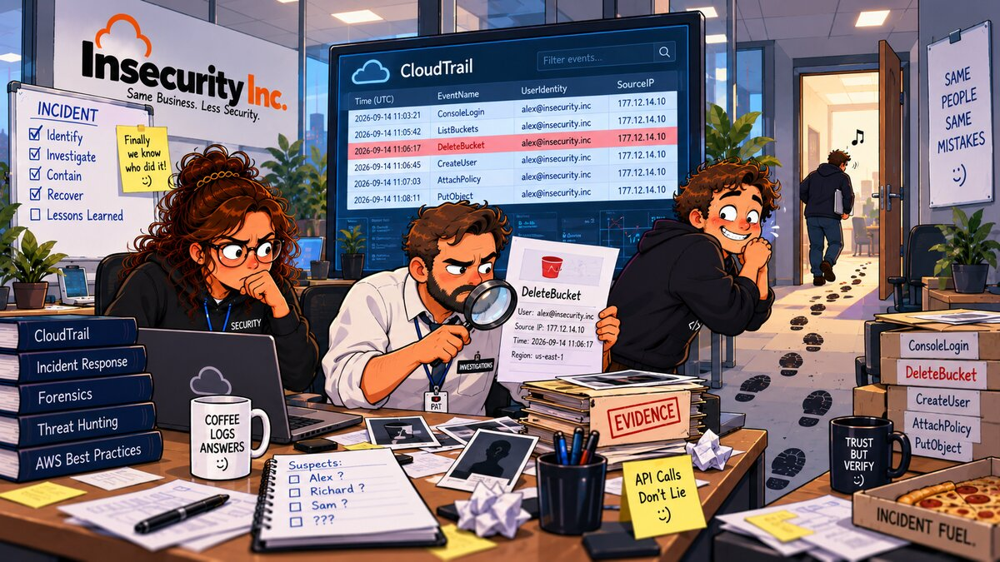

# 11 — 🕵️ CloudTrail



**Arco:** Detecção & Auditoria  
**Conceito:** Auditoria de API  
**Well-Architected:** [SEC04-BP01](https://docs.aws.amazon.com/wellarchitected/latest/security-pillar/sec_detect_investigate_events_app_service_logging.html)  
**Custo:** 🟢

## 🎬 Cenário

Na retrospectiva do capítulo 10, depois de responder "alguém escaneou a porta 22 enquanto ela esteve aberta ao mundo?", o time de segurança faz a pergunta seguinte, mais ampla: **"e quem mexeu na configuração em si? Quem abriu aquela regra, quem criou aquela credencial, quem apagou aquele bucket?"** Dessa vez o fundador responde na hora, com confiança: *"relaxa, o CloudTrail já vem ligado por padrão em toda conta AWS, isso a gente não precisa configurar."*

A frase está certa pela metade. Testado nesta conta, antes de qualquer coisa deste capítulo:

```bash
aws cloudtrail describe-trails --query 'length(trailList)' --output text
# 0 -- nenhum trail jamais existiu

aws cloudtrail lookup-events --max-results 3 --query 'Events[].[EventName,EventTime]' --output table
# ------------------------------------------
# |              LookupEvents              |
# +----------+-----------------------------+
# |  Decrypt |  2026-09-22T17:45:45-03:00  |
# |  Decrypt |  2026-09-22T17:45:45-03:00  |
# |  Decrypt |  2026-09-22T17:45:45-03:00  |
# +----------+-----------------------------+
# devolve eventos recentes normalmente, mesmo sem trail nenhum
```

As duas saídas parecem se contradizer, mas não contradizem: a segunda é o **Event History**, uma funcionalidade sempre ativa, gratuita, que guarda os últimos 90 dias de eventos de *gerenciamento* de uma conta — e é exatamente ela que sustenta a meia-verdade do fundador. A primeira é um **trail**, o recurso que precisa ser criado explicitamente para transformar esse histórico rolante em algo durável, auditável e íntegro — e é exatamente o que nunca existiu na Insecurity Inc. até este capítulo.

A diferença não é acadêmica. Ela aparece na primeira vez que alguém tenta usar o Event History para responder a uma pergunta de auditoria de verdade — e descobre, um a um, os limites que a interface amigável do console não deixa óbvios (ver Problema).

## 🚨 O Problema

1. **Event History não é um trail, e "sempre ligado" esconde um prazo de validade.** É uma janela **rolante de 90 dias**: o evento do dia 91 desaparece sozinho, sem aviso, sem exportação automática, sem backup — é assim desde sempre, é o comportamento documentado, não uma falha. Qualquer investigação, auditoria de compliance ou simplesmente "o que aconteceu há 4 meses" que dependa só do Event History já nasce impossível de responder.
2. **Event History só cobre eventos de gerenciamento — nunca eventos de dados.** Quem apagou um objeto específico do bucket de recibos (capítulo 05) ou leu um segredo específico do Secrets Manager (capítulo 08) nunca aparece ali, façam o que fizerem: só um trail com *data event selectors* configurados registra isso, e nenhum trail jamais existiu nesta conta.
3. **Sem nenhum trail, a conta falha o controle mais básico de auditoria da AWS.** Mapeado como [CloudTrail.1 — CloudTrail should be enabled and configured with at least one multi-Region trail that includes read and write management events](https://docs.aws.amazon.com/securityhub/latest/userguide/cloudtrail-controls.html#cloudtrail-1) no Security Hub, severidade **High** — CIS AWS Foundations Benchmark **v5.0.0 e v3.0.0, requisito 3.1** (v1.4.0, mesmo 3.1; v1.2.0, 2.1). Também falha [CloudTrail.3 — At least one CloudTrail trail should be enabled](https://docs.aws.amazon.com/securityhub/latest/userguide/cloudtrail-controls.html#cloudtrail-3), o cheque ainda mais elementar por trás.
4. **"CIS removeu o requisito" não é o mesmo que "parou de importar".** Dois controles do Security Hub com relação direta ao Problema deste capítulo — [CloudTrail.5, integração com CloudWatch Logs](https://docs.aws.amazon.com/securityhub/latest/userguide/cloudtrail-controls.html#cloudtrail-5) e [CloudTrail.6, bucket do trail não pode ser público](https://docs.aws.amazon.com/securityhub/latest/userguide/cloudtrail-controls.html#cloudtrail-6) — correspondiam aos requisitos CIS 3.4/3.3 na versão 1.4.0 (2.4/2.3 na 1.2.0), e **saíram do texto** nas versões 3.0.0 e 5.0.0 do benchmark. O Security Hub continua cobrando os dois controles independentemente da versão do CIS habilitada — a necessidade real por trás deles (alertar em tempo quase real, e não deixar o único arquivo de auditoria da empresa acessível ao público) não desapareceu só porque uma nova revisão de um documento de terceiros parou de listá-la. Tratar "saiu do checklist" como "não importa mais" é exatamente o tipo de raciocínio burocrático que a Insecurity Inc. vinha usando até aqui.
5. **Sem validação de integridade, um trail (se existisse) seria auditável só até alguém com acesso ao bucket decidir editar um arquivo de log.** [CloudTrail.4](https://docs.aws.amazon.com/securityhub/latest/userguide/cloudtrail-controls.html#cloudtrail-4) / CIS 3.2 (todas as versões correntes) — sem os arquivos de digest assinados, não existe prova criptográfica de que um log não foi alterado ou apagado depois da entrega.
6. **Trilha de auditoria sem alarme não detecta nada sozinha.** Mesmo um trail perfeitamente configurado só produz arquivos num bucket S3 — ninguém olha isso em tempo real. É a integração com o CloudWatch Logs (ponto 4 acima) que abre a porta para reação automática; sem ela, a auditoria é inteiramente forense (depois do fato), nunca preventiva.

## ✅ A Correção

1. **Um trail multi-região** (`is_multi_region_trail = true`, `include_global_service_events = true`), cobrindo leitura e escrita de eventos de gerenciamento em todas as regiões habilitadas da conta com uma única configuração — resolve o ponto 3 do Problema (CloudTrail.1/CIS 3.1) e é, junto do próximo ponto, a linha de base que a AWS Well-Architected SEC04-BP01 cita ao lado de VPC Flow Logs (capítulo 10) como fonte básica de investigação.
2. **Validação de integridade do arquivo de log habilitada** (`enable_log_file_validation = true`) — resolve o ponto 5 (CloudTrail.4/CIS 3.2). Gera arquivos de digest assinados no mesmo bucket, verificáveis com `aws cloudtrail validate-logs` (ver Como testar).
3. **Bucket S3 dedicado**, com a mesma linha de base dos capítulos 05/06/10 — Bucket Owner Enforced, Block Public Access nas quatro opções — mais a bucket policy de referência da própria AWS para entrega de trail (`s3:GetBucketAcl` + `s3:PutObject`, restrita ao prefixo `AWSLogs/<account-id>/`), **com o acréscimo de `aws:SourceArn`** travando a entrega ao ARN exato deste trail — a documentação chama isso de *security best practice* e recomenda adicionar à parte; o exemplo "básico" que ela mostra primeiro não inclui. Mesmo espírito de "mais restrito que a referência" dos capítulos 06 e 10 — e resolve, por conta própria (nunca fica público para começo de conversa), o mesmo problema que o CloudTrail.6 descrevia antes de a CIS remover o requisito (ponto 4 do Problema).
4. **Access logging do próprio bucket de logs** (`aws_s3_bucket_logging`), publicando num segundo bucket dedicado — resolve [CloudTrail.7](https://docs.aws.amazon.com/securityhub/latest/userguide/cloudtrail-controls.html#cloudtrail-7) / CIS 3.4 (v5.0.0/v3.0.0; 3.6 em v1.4.0; 2.6 em v1.2.0), o único controle CloudTrail-S3 que **sobreviveu** a todas as versões correntes do benchmark. Pegadinha resolvida, não vivida: com Bucket Owner Enforced (ACLs desligadas), o grupo legado "S3 Log Delivery" de sempre (concedido por ACL) simplesmente não é uma opção — a documentação da AWS já recomenda, para esse caso, conceder a permissão via bucket policy ao principal de serviço `logging.s3.amazonaws.com` em vez de ACL. É o que este capítulo faz desde o início, sem precisar descobrir isso testando (ao contrário de outras pegadinhas documentadas nos capítulos 06 e 10).
5. **Cópia em tempo real no CloudWatch Logs** (`cloud_watch_logs_group_arn` + `cloud_watch_logs_role_arn`), num log group dedicado (`/insecurity-inc/cloudtrail`) — resolve os pontos 4 e 6 do Problema (CloudTrail.5). O papel IAM que o CloudTrail assume para publicar tem a condição `aws:SourceArn` travada no ARN exato deste trail — proteção contra *confused deputy* que a documentação recomenda para a bucket policy do S3, mas cujo exemplo oficial de trust policy do papel de CloudWatch Logs **não inclui**. Mesmo acréscimo que o capítulo 10 faz para o papel de flow logs.
6. **O ARN do trail é montado à mão** (`local.trail_arn`, a partir do nome escolhido por este código), não lido do recurso depois de criado. A API `CreateTrail` valida a bucket policy e a permissão do papel de CloudWatch Logs **na hora da criação** — uma referência direta a `aws_cloudtrail.main.arn` nessas duas policies criaria uma dependência circular (a policy precisa existir antes do trail, mas só saberia o ARN do trail depois dele existir). Como o ARN de um trail é 100% previsível a partir do nome — e o nome é decidido por este código, não pela AWS —, montá-lo em `locals` quebra o ciclo sem precisar de curinga nenhum (diferente do ARN do flow log do capítulo 10, que só existe depois de criado e por isso usa curinga).
7. **`event_selector` explícito**, com `read_write_type = "All"` e `include_management_events = true` — o mesmo que o trail já teria por padrão sem o bloco, mas declarado para deixar claro, ao lado do próximo ponto, que eventos de **dados** continuam de fora.

**Dívidas em aberto.**

- **Criptografia com CMK própria (SSE-KMS) não aplicada.** [CloudTrail.2](https://docs.aws.amazon.com/securityhub/latest/userguide/cloudtrail-controls.html#cloudtrail-2) / CIS 3.5 (v5.0.0/v3.0.0; 3.7 em v1.4.0; 2.7 em v1.2.0) pede uma chave gerenciada pelo cliente; o bucket deste capítulo usa SSE-S3 (AES256), a criptografia padrão e gratuita. Uma CMK custa ~US$1/mês pro-rata (capítulo 06) — incompatível com o 🟢 deste capítulo no roadmap. Reaplicar o padrão do capítulo 06 (`kms_key_id` no trail) é a forma direta de fechar essa dívida, ao custo de sair do "quase grátis".
- **Eventos de dados (S3, Lambda, DynamoDB...) não habilitados.** Cobrança por evento entregue (ao contrário de eventos de gerenciamento, cuja primeira cópia é gratuita — ver nota de custo abaixo) e, mais relevante para este repositório, exigiria apontar para recursos de **outros** capítulos (o bucket de recibos do capítulo 05/06, por exemplo) — o que quebraria a regra de cada capítulo ser autocontido, sem acoplamento entre pastas.
- **CloudTrail Insights não habilitado.** Detecta automaticamente padrões incomuns de volume de chamada de API (ex.: um pico repentino de `ConsoleLogin` falho), mas é cobrado por evento analisado, à parte — mais uma feature paga que não se encaixa no 🟢 deste capítulo.
- **Sem filtro de métrica nem alarme sobre os eventos do CloudWatch Logs.** A cópia em tempo real (ponto 5 da Correção) existe, mas nada reage a ela ainda — nem um alarme de uso do usuário root, nem de chamada não autorizada, nem de mudança de política IAM (os controles legados `CloudWatch.1` a `CloudWatch.14`, mapeados no CIS v1.2.0/v1.4.0 e reclassificados como "checagem manual" nas versões 3.0.0/5.0.0). Fechar essa dívida com reação automática de verdade é o assunto do capítulo 13 (EventBridge).
- **Trail de conta única, não de organização.** Um *organization trail* centralizaria a auditoria de todas as contas-membro num só bucket — mas a Insecurity Inc. decidiu manter conta única até o capítulo 13 (ver `CLAUDE.md`); organização e múltiplas contas só entram nos capítulos 14/15.
- **Access logging do bucket de logs é best-effort e pode não aparecer durante o teste.** A própria documentação da AWS avisa que a entrega "pode levar algumas horas" — fora da janela realista de uma sessão de laboratório (ver Como testar, passo 6).

## 💵 Nota de custo

Diferente do capítulo 10 (VPC Flow Logs), o CloudTrail tem uma faixa **permanentemente gratuita** para o cenário deste capítulo, não limitada aos 12 meses do Free Tier (que esta conta já não tem):

- **A primeira cópia de eventos de gerenciamento entregue a um bucket S3, por trail, é sempre gratuita** — é exatamente o que este capítulo usa. Cópias adicionais custam US$2,00 por 100.000 eventos.
- **Entrega ao CloudWatch Logs tem custo próprio, em duas partes**: US$0,25/GB do lado do CloudTrail (a entrega em si) **mais** a tarifa normal de ingestão do CloudWatch Logs (US$0,50/GB, mesma tarifa do capítulo 10) — US$0,75/GB combinado. Para o volume de um laboratório (algumas dezenas de chamadas de API durante o teste, poucos KB) isso fica muito abaixo de um centavo de dólar.
- **Armazenamento S3** dos arquivos de log e digest é cobrado à parte, na tarifa padrão do S3 — também irrelevante no volume deste capítulo.
- Eventos de **dados** e **Insights**, deliberadamente não habilitados aqui (ver Dívidas em aberto), são os itens realmente caros do CloudTrail — cobrados por evento, sem cópia gratuita.

## 🧪 Como aplicar

Três caminhos equivalentes — escolha o que fizer sentido para você.

### 🏗️ Opção 1 — Terraform (caminho testado neste repo)

```bash
terraform init
terraform apply
```

### ⌨️ Opção 2 — AWS CLI

```bash
REGION=$(aws configure get region)
ACCOUNT_ID=$(aws sts get-caller-identity --query Account --output text)
for v in REGION ACCOUNT_ID; do eval "val=\$$v"; [ -n "$val" ] && [ "$val" != None ] || echo "$v VAZIA -- não continue sem corrigir (confira o login AWS e o 'aws configure')"; done

TRAIL_NAME=insecurity-inc-trail
TRAIL_ARN="arn:aws:cloudtrail:${REGION}:${ACCOUNT_ID}:trail/${TRAIL_NAME}"
SUFFIX=$(openssl rand -hex 4)
BUCKET_NAME="insecurity-inc-cloudtrail-logs-${SUFFIX}"
ACCESS_LOGS_BUCKET="insecurity-inc-cloudtrail-logs-access-${SUFFIX}"

# 1. Bucket de destino do trail: privado, Bucket Owner Enforced, Block
#    Public Access, SSE-S3 -- mesma linha de base dos capítulos 05/06/10.
aws s3api create-bucket --bucket "$BUCKET_NAME" --region "$REGION"
aws s3api put-bucket-tagging --bucket "$BUCKET_NAME" \
  --tagging 'TagSet=[{Key=project,Value=insecurity-inc},{Key=env,Value=lab},{Key=chapter,Value=11}]'
aws s3api put-bucket-ownership-controls --bucket "$BUCKET_NAME" \
  --ownership-controls Rules=[{ObjectOwnership=BucketOwnerEnforced}]
aws s3api put-public-access-block --bucket "$BUCKET_NAME" \
  --public-access-block-configuration BlockPublicAcls=true,IgnorePublicAcls=true,BlockPublicPolicy=true,RestrictPublicBuckets=true
aws s3api put-bucket-encryption --bucket "$BUCKET_NAME" \
  --server-side-encryption-configuration '{"Rules":[{"ApplyServerSideEncryptionByDefault":{"SSEAlgorithm":"AES256"}}]}'

# 2. Bucket de access logging do bucket acima (Security Hub CloudTrail.7)
aws s3api create-bucket --bucket "$ACCESS_LOGS_BUCKET" --region "$REGION"
aws s3api put-bucket-tagging --bucket "$ACCESS_LOGS_BUCKET" \
  --tagging 'TagSet=[{Key=project,Value=insecurity-inc},{Key=env,Value=lab},{Key=chapter,Value=11}]'
aws s3api put-bucket-ownership-controls --bucket "$ACCESS_LOGS_BUCKET" \
  --ownership-controls Rules=[{ObjectOwnership=BucketOwnerEnforced}]
aws s3api put-public-access-block --bucket "$ACCESS_LOGS_BUCKET" \
  --public-access-block-configuration BlockPublicAcls=true,IgnorePublicAcls=true,BlockPublicPolicy=true,RestrictPublicBuckets=true
aws s3api put-bucket-encryption --bucket "$ACCESS_LOGS_BUCKET" \
  --server-side-encryption-configuration '{"Rules":[{"ApplyServerSideEncryptionByDefault":{"SSEAlgorithm":"AES256"}}]}'

# 3. Bucket policy do bucket de access logs -- com Bucket Owner Enforced,
#    ACL não é uma opção; a permissão vai direto para o principal de
#    serviço logging.s3.amazonaws.com, travada por aws:SourceArn/SourceAccount.
cat > /tmp/ct-access-logs-policy.json <<EOF
{
  "Version": "2012-10-17",
  "Statement": [{
    "Sid": "S3ServerAccessLogsPolicy",
    "Effect": "Allow",
    "Principal": {"Service": "logging.s3.amazonaws.com"},
    "Action": "s3:PutObject",
    "Resource": "arn:aws:s3:::${ACCESS_LOGS_BUCKET}/cloudtrail-bucket-access-logs/*",
    "Condition": {
      "ArnLike": {"aws:SourceArn": "arn:aws:s3:::${BUCKET_NAME}"},
      "StringEquals": {"aws:SourceAccount": "${ACCOUNT_ID}"}
    }
  }]
}
EOF
aws s3api put-bucket-policy --bucket "$ACCESS_LOGS_BUCKET" --policy file:///tmp/ct-access-logs-policy.json

aws s3api put-bucket-logging --bucket "$BUCKET_NAME" --bucket-logging-status "{
  \"LoggingEnabled\": {\"TargetBucket\": \"${ACCESS_LOGS_BUCKET}\", \"TargetPrefix\": \"cloudtrail-bucket-access-logs/\"}
}"

# 4. Bucket policy do bucket de logs do trail -- referência oficial da AWS
#    (GetBucketAcl + PutObject em AWSLogs/<account-id>/*), com aws:SourceArn
#    travado no ARN exato deste trail (a AWS recomenda à parte; o exemplo
#    básico da documentação não inclui).
cat > /tmp/ct-bucket-policy.json <<EOF
{
  "Version": "2012-10-17",
  "Statement": [
    {
      "Sid": "AWSCloudTrailAclCheck",
      "Effect": "Allow",
      "Principal": {"Service": "cloudtrail.amazonaws.com"},
      "Action": "s3:GetBucketAcl",
      "Resource": "arn:aws:s3:::${BUCKET_NAME}",
      "Condition": {"StringEquals": {"aws:SourceArn": "${TRAIL_ARN}"}}
    },
    {
      "Sid": "AWSCloudTrailWrite",
      "Effect": "Allow",
      "Principal": {"Service": "cloudtrail.amazonaws.com"},
      "Action": "s3:PutObject",
      "Resource": "arn:aws:s3:::${BUCKET_NAME}/AWSLogs/${ACCOUNT_ID}/*",
      "Condition": {
        "StringEquals": {
          "s3:x-amz-acl": "bucket-owner-full-control",
          "aws:SourceArn": "${TRAIL_ARN}"
        }
      }
    }
  ]
}
EOF
aws s3api put-bucket-policy --bucket "$BUCKET_NAME" --policy file:///tmp/ct-bucket-policy.json

# 5. Log group dedicado + papel IAM que o CloudTrail assume para publicar
#    nele (com aws:SourceArn -- proteção contra confused deputy que a
#    documentação recomenda para a bucket policy do S3, mas cujo exemplo de
#    trust policy deste papel não inclui; mesmo acréscimo do capítulo 10).
aws logs create-log-group --log-group-name /insecurity-inc/cloudtrail \
  --tags project=insecurity-inc,env=lab,chapter=11
aws logs put-retention-policy --log-group-name /insecurity-inc/cloudtrail --retention-in-days 1
LOG_GROUP_ARN=$(aws logs describe-log-groups --log-group-name-prefix /insecurity-inc/cloudtrail --query 'logGroups[0].arn' --output text)
[ -n "$LOG_GROUP_ARN" ] && [ "$LOG_GROUP_ARN" != None ] || echo "LOG_GROUP_ARN VAZIA -- não continue sem corrigir (o create-log-group falhou)"
# O ARN devolvido pela API já vem com ":*" no final -- ver capítulo 10 para a
# divergência frente ao atributo `arn` do Terraform (vale igual aqui).

cat > /tmp/ct-cwl-trust.json <<EOF
{
  "Version": "2012-10-17",
  "Statement": [{
    "Effect": "Allow",
    "Principal": {"Service": "cloudtrail.amazonaws.com"},
    "Action": "sts:AssumeRole",
    "Condition": {"StringEquals": {"aws:SourceArn": "${TRAIL_ARN}"}}
  }]
}
EOF
ROLE_ARN=$(aws iam create-role --role-name insecurity-inc-cloudtrail-cloudwatch-logs \
  --assume-role-policy-document file:///tmp/ct-cwl-trust.json \
  --tags Key=project,Value=insecurity-inc Key=env,Value=lab Key=chapter,Value=11 \
  --query Role.Arn --output text)
[ -n "$ROLE_ARN" ] && [ "$ROLE_ARN" != None ] || echo "ROLE_ARN VAZIA -- não continue sem corrigir (o create-role falhou)"

# Nomeação de log stream documentada oficialmente:
# "{account-id}_CloudTrail_{home-region-do-trail}", com sufixo numérico
# ("_2", "_3"...) sob volume alto -- o curinga final cobre esse caso.
cat > /tmp/ct-cwl-permissions.json <<EOF
{
  "Version": "2012-10-17",
  "Statement": [{
    "Effect": "Allow",
    "Action": ["logs:CreateLogStream", "logs:PutLogEvents"],
    "Resource": "${LOG_GROUP_ARN%:*}:log-stream:${ACCOUNT_ID}_CloudTrail_${REGION}*"
  }]
}
EOF
aws iam put-role-policy --role-name insecurity-inc-cloudtrail-cloudwatch-logs \
  --policy-name insecurity-inc-cloudtrail-cloudwatch-logs-publish --policy-document file:///tmp/ct-cwl-permissions.json

sleep 10   # propagação do IAM antes do create-trail tentar assumir o papel

# 6. O trail em si -- multi-região, validação de integridade, todos os
#    eventos de gerenciamento, cópia em tempo real no CloudWatch Logs.
aws cloudtrail create-trail --name "$TRAIL_NAME" --s3-bucket-name "$BUCKET_NAME" \
  --is-multi-region-trail --include-global-service-events --enable-log-file-validation \
  --cloud-watch-logs-log-group-arn "${LOG_GROUP_ARN}" --cloud-watch-logs-role-arn "$ROLE_ARN" \
  --tags-list Key=project,Value=insecurity-inc Key=env,Value=lab Key=chapter,Value=11

aws cloudtrail put-event-selectors --trail-name "$TRAIL_NAME" \
  --event-selectors '[{"ReadWriteType": "All", "IncludeManagementEvents": true}]'

# CreateTrail NÃO liga o logging sozinho -- diferente do console (que liga
# automaticamente) e do Terraform (cujo enable_logging=true por padrão faz
# a mesma coisa por trás). Sem este passo, o trail existiria configurado e
# "desligado", sem entregar nada -- silenciosamente.
aws cloudtrail start-logging --name "$TRAIL_NAME"
```

### 🖥️ Opção 3 — Console (GUI)

1. **Bucket de logs do trail:** **S3** → **Create bucket** → nome `insecurity-inc-cloudtrail-logs-<algo-único-seu>` → **Object Ownership**: **ACLs disabled (recommended)** → mantenha as quatro opções de **Block Public Access** marcadas → **Default encryption**: **Amazon S3 managed keys (SSE-S3)** → **Create bucket**. Tags do capítulo em **Properties** → **Tags** → **Edit**.
2. **Bucket de access logging:** repita o passo 1 para um segundo bucket, `insecurity-inc-cloudtrail-logs-access-<algo-único-seu>`.
3. **Ativar o access logging** do bucket do passo 1: selecione-o → **Properties** → seção **Server access logging** → **Edit** → **Enable** → **Target bucket**: o bucket do passo 2 → **Target prefix**: `cloudtrail-bucket-access-logs/` → **Save changes**. O console atualiza a bucket policy do bucket de destino automaticamente (concede `s3:PutObject` ao principal `logging.s3.amazonaws.com`), já que ele tem ACLs desligadas.
4. **Papel IAM para o CloudWatch Logs:** **IAM** → **Roles** → **Create role** → **Custom trust policy** → cole o JSON de confiança do passo 5 da Opção 2 (com `$ACCOUNT_ID`, `$REGION` e o ARN do trail — que você decide agora, antes de criar o trail: `arn:aws:cloudtrail:<região>:<account-id>:trail/insecurity-inc-trail` — preenchidos à mão) → **Next** → **Create policy** (aba nova) → **JSON** → cole a política de permissões do mesmo passo (com o ARN do log group que você vai criar no próximo passo) → nomeie e crie → volte à criação do papel, anexe essa política → nome do papel `insecurity-inc-cloudtrail-cloudwatch-logs` → **Create role**.
5. **Log group:** **CloudWatch** → **Log groups** → **Create log group** → nome `/insecurity-inc/cloudtrail`, **Retention setting** 1 day → tags do capítulo → **Create**.
6. **O trail:** **CloudTrail** → **Trails** → **Create trail** → **Trail name**: `insecurity-inc-trail` → **Enable for all accounts in my organization**: desmarcado → **Storage location**: **Use existing S3 bucket** → o bucket do passo 1 (se o console avisar que a bucket policy precisa ser atualizada, aceite — ele aplica a versão básica da AWS; a versão com `aws:SourceArn` dos outros caminhos é mais restrita, mas o console não oferece esse campo extra na wizard) → **Log file validation**: **Enabled** → **SNS notification delivery**: desabilitado → **CloudWatch Logs**: **Enabled** → **Existing** log group (passo 5) e **Existing** papel IAM (passo 4) → tags do capítulo → **Next** → **Management events**: **Read** e **Write** marcados, sem exclusões → **Data events**: nenhum selecionado → **Next** → **Create trail**. O console liga o logging automaticamente ao criar (diferente do caminho CLI, que exige `start-logging` à parte).

## 🧾 Como testar

O objetivo é provar, na prática: a configuração do trail bate exatamente com a Correção; a validação de integridade funciona de verdade (não só "está marcada"); uma chamada de API real, marcada de forma única, aparece nos três destinos que este capítulo entrega (Event History, CloudWatch Logs e S3); e o Block Public Access do bucket — ao contrário do que o capítulo 06 mostrou para o KMS — realmente impede a versão pública do Cenário.

Requer o Terraform, e deve rodar **dentro da pasta do capítulo**.

```bash
TRAIL_ARN=$(terraform output -raw trail_arn)
BUCKET_NAME=$(terraform output -raw cloudtrail_bucket_name)
LOG_GROUP=$(terraform output -raw cloudwatch_log_group_name)
REGION=$(aws configure get region)

for v in TRAIL_ARN BUCKET_NAME LOG_GROUP REGION; do eval "val=\$$v"; [ -n "$val" ] && [ "$val" != None ] || echo "$v VAZIA -- não continue sem corrigir (rode dentro da pasta do capítulo e confira o login AWS)"; done

# 0. Pré-condição: sem deriva.
terraform plan -detailed-exitcode > /dev/null; echo "plan exit=$?  (0 = sem deriva)"

# 1. Inventário: o trail tem exatamente a configuração que a Correção descreve.
aws cloudtrail get-trail-status --name "$TRAIL_ARN" --query '{Logging:IsLogging,UltimaEntrega:LatestDeliveryTime,UltimoDigest:LatestDigestDeliveryTime}'
aws cloudtrail describe-trails --trail-name-list "$TRAIL_ARN" --query 'trailList[0].{MultiRegiao:IsMultiRegionTrail,Validacao:LogFileValidationEnabled,Bucket:S3BucketName,LogGroup:CloudWatchLogsLogGroupArn}'
# Esperado: Logging=true, MultiRegiao=true, Validacao=true, e o bucket/log
# group deste capítulo.

# 2. Validação de integridade AO VIVO -- não só "a flag está marcada": usa
#    os digests de verdade entregues no bucket para provar que nada foi
#    alterado desde a entrega. Logo após a criação do trail o esperado é
#    "No digests found" (ainda não houve entrega). Testado nesta conta, uns
#    minutos depois, com entregas já feitas:
aws cloudtrail validate-logs --trail-arn "$TRAIL_ARN" --start-time "$(date -u -d '15 minutes ago' +%Y-%m-%dT%H:%M:%SZ)" 2>&1 | tail -5
# Results found for ...:
# 1/1 digest files valid
# (nunca um erro de assinatura -- se algum arquivo tivesse sido alterado ou
# apagado depois da entrega, apareceria aqui como inválido ou faltante)

# 3. Gera um evento de gerenciamento real e rastreável -- o marcador único
#    no path-prefix (que não existe; sem side effect) permite achar ESTE
#    evento específico nos três destinos, sem ambiguidade com outra
#    chamada ListRoles qualquer feita na conta.
MARKER="chapter-11-test-$(date +%s)"
aws iam list-roles --path-prefix "/${MARKER}/" > /dev/null

# 4. Aparece no Event History -- não depende de trail nenhum, é a
#    funcionalidade sempre ligada do Cenário (lookup-events não filtra por
#    parâmetro de request, só por EventName/EventSource/etc. -- por isso a
#    checagem aqui é pelo nome do evento, não pelo marcador).
for i in 1 2 3 4 5 6; do
  RESULT=$(aws cloudtrail lookup-events --lookup-attributes AttributeKey=EventName,AttributeValue=ListRoles \
    --max-results 1 --query 'Events[0].EventTime' --output text)
  [ -n "$RESULT" ] && [ "$RESULT" != None ] && break
  sleep 20
done
echo "$RESULT"

# 5. Chega no CloudWatch Logs -- a documentação estima ~5 min; testado
#    nesta conta, o marcador apareceu em 139s.
for i in $(seq 1 20); do
  MSG=$(aws logs filter-log-events --log-group-name "$LOG_GROUP" --filter-pattern "$MARKER" --query 'events[0].message' --output text 2>/dev/null)
  [ -n "$MSG" ] && [ "$MSG" != None ] && break
  sleep 15
done
echo "${MSG:0:400}"
# Se vazio depois de uns minutos, espere mais um pouco e repita -- a
# entrega ao CloudWatch Logs não é garantida num prazo fixo.

# 6. Chega no bucket S3 (a fonte de verdade do CloudTrail -- sem expiração
#    automática, ao contrário do Event History). Testado nesta conta: 142s.
ACCOUNT_ID=$(aws sts get-caller-identity --query Account --output text)
mkdir -p /tmp/ct-test-logs
for i in $(seq 1 20); do
  aws s3 sync "s3://${BUCKET_NAME}/AWSLogs/${ACCOUNT_ID}/CloudTrail/${REGION}/$(date -u +%Y/%m/%d)/" /tmp/ct-test-logs --quiet
  gunzip -k -f /tmp/ct-test-logs/*.json.gz 2>/dev/null
  grep -l "$MARKER" /tmp/ct-test-logs/*.json 2>/dev/null && break
  sleep 15
done

# 7. O ponto central: o Block Public Access do S3 -- ao contrário da key
#    policy do KMS no capítulo 06 -- realmente barra a versão pública do
#    Cenário. Tentativa de tornar o bucket público por ACL.
aws s3api put-bucket-acl --bucket "$BUCKET_NAME" --acl public-read 2>&1
# Testado nesta conta:
# AccessDenied: ... is not authorized to perform: s3:PutBucketAcl on
# resource "arn:aws:s3:::insecurity-inc-cloudtrail-logs-..." because public
# ACLs are prevented by the BlockPublicAcls setting in S3 Block Public
# Access. Contraste direto com o capítulo 06: KMS não tem nenhuma trava
# equivalente -- lá, o put-key-policy público é aceito sem erro nenhum.

# 8. Access logging do bucket de logs -- best effort, pode não aparecer
#    dentro da janela do teste (ver README, Dívidas em aberto).
ACCESS_LOGS_BUCKET=$(terraform output -raw access_logs_bucket_name)
aws s3 ls "s3://${ACCESS_LOGS_BUCKET}/cloudtrail-bucket-access-logs/" 2>&1 | tail -5
echo "(vazio aqui é esperado -- a AWS estima 'algumas horas' para a primeira entrega)"
```

## 🧹 Como destruir

### 🏗️ Terraform

```bash
terraform destroy
```

### ⌨️ AWS CLI

```bash
TRAIL_NAME=insecurity-inc-trail
BUCKET_NAME=$(aws cloudtrail describe-trails --trail-name-list "$TRAIL_NAME" --query 'trailList[0].S3BucketName' --output text 2>/dev/null)
ACCESS_LOGS_BUCKET=$(aws s3api list-buckets --query "Buckets[?starts_with(Name, 'insecurity-inc-cloudtrail-logs-access-')].Name | [0]" --output text)

aws cloudtrail stop-logging --name "$TRAIL_NAME" 2>/dev/null
aws cloudtrail delete-trail --name "$TRAIL_NAME" 2>/dev/null

aws iam delete-role-policy --role-name insecurity-inc-cloudtrail-cloudwatch-logs --policy-name insecurity-inc-cloudtrail-cloudwatch-logs-publish 2>/dev/null
aws iam delete-role --role-name insecurity-inc-cloudtrail-cloudwatch-logs 2>/dev/null
aws logs delete-log-group --log-group-name /insecurity-inc/cloudtrail 2>/dev/null

[ -n "$BUCKET_NAME" ] && [ "$BUCKET_NAME" != None ] && aws s3 rm "s3://${BUCKET_NAME}" --recursive && aws s3api delete-bucket --bucket "$BUCKET_NAME"
[ -n "$ACCESS_LOGS_BUCKET" ] && [ "$ACCESS_LOGS_BUCKET" != None ] && aws s3 rm "s3://${ACCESS_LOGS_BUCKET}" --recursive && aws s3api delete-bucket --bucket "$ACCESS_LOGS_BUCKET"
```

### 🖥️ Console (GUI)

1. **CloudTrail** → **Trails** → `insecurity-inc-trail` → **Delete** → confirme (a AWS para o logging e apaga a configuração do trail; os arquivos já entregues ao S3 **não** são apagados junto).
2. **IAM** → **Roles** → `insecurity-inc-cloudtrail-cloudwatch-logs` → remova a política inline (aba **Permissions**) → **Delete**.
3. **CloudWatch** → **Log groups** → `/insecurity-inc/cloudtrail` → **Actions** → **Delete log group(s)**.
4. **S3** → selecione o bucket de logs do trail → **Empty** → digite o nome para confirmar → **Empty**. Repita para o bucket de access logging. Com os dois vazios, selecione cada um → **Delete** → confirme.

Depois do destroy (de qualquer um dos três caminhos), confira que não sobrou nada:

```bash
aws cloudtrail describe-trails --query "trailList[?contains(Name, 'insecurity-inc')].Name" --output text
aws iam get-role --role-name insecurity-inc-cloudtrail-cloudwatch-logs 2>&1 | tail -1
aws logs describe-log-groups --log-group-name-prefix /insecurity-inc/cloudtrail --query 'logGroups[].logGroupName' --output text
aws s3api list-buckets --query "Buckets[?starts_with(Name, 'insecurity-inc-cloudtrail-logs')].Name" --output text
# Esperado: as quatro saídas vazias (a do IAM, um erro "NoSuchEntity")
```

## 📚 Referências

- [SEC04-BP01 — Configure service and application logging](https://docs.aws.amazon.com/wellarchitected/latest/security-pillar/sec_detect_investigate_events_app_service_logging.html) — AWS Well-Architected Framework, Security Pillar; cita CloudTrail ao lado de VPC Flow Logs (capítulo 10) como fonte básica de investigação.
- [CloudTrail concepts — Event history](https://docs.aws.amazon.com/awscloudtrail/latest/userguide/cloudtrail-concepts.html#cloudtrail-concepts-event-history) — janela rolante de 90 dias de eventos de gerenciamento, sempre ativa, base do ponto 1 do Problema.
- [CloudTrail concepts — Trails, multi-Region e single-Region trails](https://docs.aws.amazon.com/awscloudtrail/latest/userguide/cloudtrail-concepts.html#cloudtrail-concepts-trails) — diferença entre Event History e trail, e por que `IncludeGlobalServiceEvents` é obrigatório em `true` para um trail multi-região.
- [Amazon S3 bucket policy for CloudTrail](https://docs.aws.amazon.com/awscloudtrail/latest/userguide/create-s3-bucket-policy-for-cloudtrail.html) — a bucket policy de referência (GetBucketAcl/PutObject) e a recomendação, à parte, de acrescentar `aws:SourceArn` — base da Correção, ponto 3.
- [Enabling log file integrity validation for CloudTrail](https://docs.aws.amazon.com/awscloudtrail/latest/userguide/cloudtrail-log-file-validation-enabling.html) e [`validate-logs`](https://docs.aws.amazon.com/cli/latest/reference/cloudtrail/validate-logs.html) — mecanismo de digest assinado e o comando usado no teste ao vivo (Como testar, passo 2).
- [Sending events to CloudWatch Logs](https://docs.aws.amazon.com/awscloudtrail/latest/userguide/send-cloudtrail-events-to-cloudwatch-logs.html) e [CloudWatch log group and log stream naming for CloudTrail](https://docs.aws.amazon.com/awscloudtrail/latest/userguide/cloudwatch-log-group-log-stream-naming-for-cloudtrail.html) — a policy de referência do papel IAM (sem `aws:SourceArn`, acrescentado aqui) e o padrão exato de nome de log stream usado no `Resource` da política deste capítulo.
- [Enabling Amazon S3 server access logging](https://docs.aws.amazon.com/AmazonS3/latest/userguide/enable-server-access-logging.html) — a exigência de bucket policy (em vez de ACL) para o destino de access logging quando Bucket Owner Enforced está ativo; base da Correção, ponto 4.
- AWS Security Hub — [CloudTrail controls (CloudTrail.1–CloudTrail.10)](https://docs.aws.amazon.com/securityhub/latest/userguide/cloudtrail-controls.html) — descrição de cada controle citado neste capítulo.
- [CIS AWS Foundations Benchmark in Security Hub](https://docs.aws.amazon.com/securityhub/latest/userguide/cis-aws-foundations-benchmark.html) — tabela de mapeamento de controles por versão do benchmark, incluindo os dois controles (CloudTrail.5/CloudTrail.6) removidos em v3.0.0/v5.0.0, base do ponto 4 do Problema.
- [AWS CloudTrail Pricing](https://aws.amazon.com/cloudtrail/pricing/) — primeira cópia de eventos de gerenciamento permanentemente gratuita, e a tarifa combinada (CloudTrail + CloudWatch Logs) para a integração em tempo real; base da Nota de custo.
- Terraform AWS provider: [`aws_cloudtrail`](https://registry.terraform.io/providers/hashicorp/aws/latest/docs/resources/cloudtrail), [`aws_s3_bucket_logging`](https://registry.terraform.io/providers/hashicorp/aws/latest/docs/resources/s3_bucket_logging), [`aws_s3_bucket_policy`](https://registry.terraform.io/providers/hashicorp/aws/latest/docs/resources/s3_bucket_policy), [`aws_iam_role_policy`](https://registry.terraform.io/providers/hashicorp/aws/latest/docs/resources/iam_role_policy).
