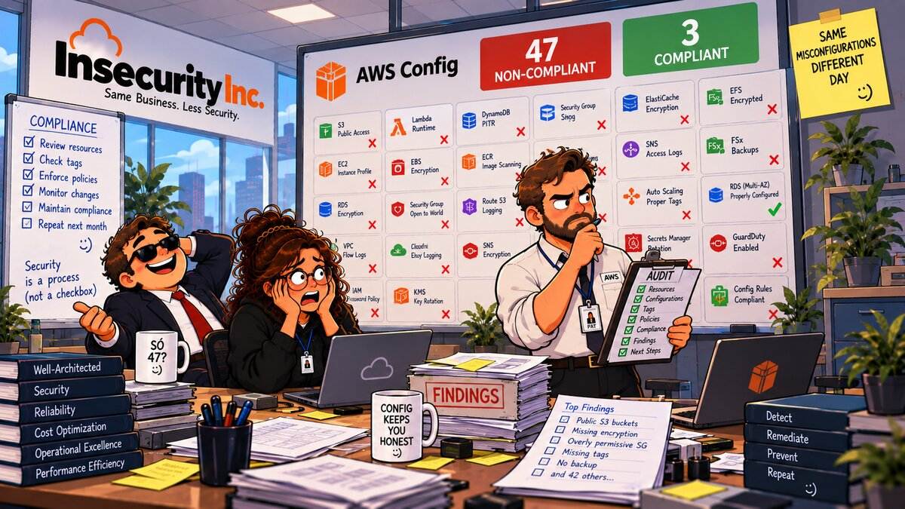

# 12 — 📋 AWS Config



**Arco:** Detecção & Auditoria  
**Conceito:** Compliance contínuo  
**Well-Architected:** [SEC01-BP03](https://docs.aws.amazon.com/wellarchitected/latest/security-pillar/sec_securely_operate_control_objectives.html)  
**Custo:** 🟡

## 🎬 Cenário

Os capítulos 08, 09 e 10 já apontaram o dedo para este capítulo — em prosa, sem nunca ligar nada. Cada um documentou, no próprio Problema ou nas próprias Referências, um controle detectivo específico que "só chega no capítulo 12":

- **Capítulo 08 (Secrets Manager):** cinco regras gerenciadas do Config — `secretsmanager-rotation-enabled-check`, `secretsmanager-scheduled-rotation-success-check`, `secretsmanager-secret-periodic-rotation`, `secretsmanager-secret-unused`, `secretsmanager-using-cmk` — citadas como cobertura que existe, mas está desligada.
- **Capítulo 09 (Security Groups):** quatro regras — `restricted-ssh`, `restricted-common-ports`, `vpc-default-security-group-closed`, `vpc-sg-open-only-to-authorized-ports` — citadas no Problema (ponto 6) como o que teria avisado sobre a porta 22 aberta, se estivesse ligado.
- **Capítulo 10 (VPC Flow Logs):** uma regra — `vpc-flow-logs-enabled` — citada como a regra por trás do próprio Security Hub EC2.6 que o capítulo audita à mão.

Dez promessas, feitas por três capítulos diferentes, nenhuma cumprida até agora. A auditoria interna, revisando os relatórios anteriores, faz a pergunta que finalmente força a promessa a virar código: *"todo esse Terraform prova que a configuração estava certa no momento em que rodamos `apply`. E depois? Se alguém reabrir alguma coisa — 'só até resolver', como o fundador fez com a porta 22 no capítulo 09 — quem percebe, e quanto tempo depois?"*

O CloudTrail do capítulo 11 não responde isso: ele prova que uma chamada de API aconteceu, não que a configuração resultante está — ou continua — correta. E ninguém fica lendo CloudTrail o dia inteiro (isso é o capítulo 13). `terraform plan` também não ajuda sozinho: pegaria a deriva **se** alguém rodasse, no diretório certo, com o state certo, regularmente — e um recurso alterado por fora deste repositório (Console, CLI, outra automação) nem aparece no state deste Terraform para o `plan` comparar. Faltava um mecanismo que reavalia a configuração real da conta continuamente, independente de alguém estar olhando.

## 🚨 O Problema

1. **Nenhum mecanismo de verificação contínua jamais existiu nesta conta.** Testado antes deste capítulo: `aws configservice describe-configuration-recorders` devolve `[]`. Toda "correção" dos capítulos 01–11 foi conferida uma única vez, no momento do `apply` — nunca mais depois disso. Mapeado no CIS AWS Foundations Benchmark como *Ensure AWS Config is enabled in all regions* — v1.2.0, controle 2.5; v1.4.0, 3.5; v3.0.0 e v5.0.0, 3.3 — reprovado, hoje, por ausência total do serviço.
2. **Dez promessas específicas, feitas em prosa nos capítulos 08/09/10, nunca viraram configuração real.** Cada uma aponta para uma regra gerenciada nomeada (lista no Cenário); nenhuma delas jamais existiu como recurso na conta.
3. **Mesmo o controle mais básico do Security Hub sobre o próprio Config reprovaria hoje.** [Config.1](https://docs.aws.amazon.com/console/securityhub/Config.1/remediation) — *AWS Config should be enabled and use the service-linked role* — severidade **Critical**, checa três coisas ao mesmo tempo: Config habilitado na região, gravação de **todos** os recursos cobertos pelos controles habilitados, e uso do papel vinculado a serviço `AWSServiceRoleForConfig`. As três falham por ausência total do serviço — e (adiantando: ver Dívidas em aberto) a terceira parte de novo, de propósito, mesmo depois da Correção.
4. **CloudTrail prova evento; não prova estado, nem por quanto tempo.** Um `PutBucketAcl` aparece no trail assim que acontece — mas saber se o bucket **está**, agora, compatível com Block Public Access, ou há quanto tempo uma regra de security group indevida está aberta, exige juntar dezenas de eventos brutos manualmente. Nenhuma ferramenta deste laboratório, até aqui, responde isso de forma direta e contínua.

## ✅ A Correção

1. **Configuration recorder com gravação contínua, mas escopo por inclusão** (`recording_strategy.use_only = INCLUSION_BY_RESOURCE_TYPES`) — só os três tipos de recurso que as dez regras deste capítulo realmente precisam: `AWS::EC2::SecurityGroup`, `AWS::EC2::VPC`, `AWS::SecretsManager::Secret`. Não `ALL_SUPPORTED_RESOURCE_TYPES` — que é o que o Security Hub Config.1 exige, e que este capítulo decide não fazer, de propósito, por custo (ver Dívidas em aberto). Gravação **contínua**, não periódica: US$0,003 por item, contra US$0,012 da periódica (ver Nota de custo) — só grava algo quando a configuração de um recurso desses três tipos realmente muda.
2. **Papel vinculado a serviço (`AWSServiceRoleForConfig`)**, não um papel IAM próprio com a managed policy `AWS_ConfigRole` — que é exatamente o padrão que os capítulos 10 e 11 usaram para flow logs e CloudTrail. Aqui a escolha é o oposto de propósito: é **literalmente** o que o Security Hub Config.1 audita ("... and uses the service-linked role"). Um papel próprio, por mais bem construído, reprovaria esse controle específico por padrão.
3. **Bucket S3 dedicado**, mesma linha de base dos capítulos 05/06/10/11 (Bucket Owner Enforced, Block Public Access nas quatro opções, SSE-S3) — mais a bucket policy de referência oficial da AWS para o delivery channel do Config (três statements: `AWSConfigBucketPermissionsCheck`, `AWSConfigBucketExistenceCheck`, `AWSConfigBucketDelivery`), **com o acréscimo de `aws:SourceArn`** — a documentação mostra só `aws:SourceAccount`; mesmo padrão "mais restrito que a referência" dos capítulos 06/10/11. **Pegadinha resolvida, não vivida:** o papel vinculado a serviço do ponto 2 **não tem permissão de escrever no S3** — quem entrega os arquivos é o principal de serviço `config.amazonaws.com` diretamente, e é ele (não o papel) que a bucket policy precisa autorizar. Usar o SLR não elimina a necessidade da bucket policy; só muda quem a documentação diz que precisa dela.
4. **Dez regras gerenciadas, uma para cada promessa** feita nos capítulos 08/09/10 — mapeamento completo:

   | Regra (nome) | Identifier | Fecha a promessa de | Security Hub / CIS |
   |---|---|---|---|
   | `restricted-ssh` | `INCOMING_SSH_DISABLED` | Cap. 09, Problema pt. 6 | — |
   | `restricted-common-ports` | `RESTRICTED_INCOMING_TRAFFIC` | Cap. 09, Problema pt. 6 | — |
   | `vpc-default-security-group-closed` | `VPC_DEFAULT_SECURITY_GROUP_CLOSED` | Cap. 09, Problema pt. 6 | EC2.2 |
   | `vpc-sg-open-only-to-authorized-ports` | `VPC_SG_OPEN_ONLY_TO_AUTHORIZED_PORTS` | Cap. 09, Problema pt. 6 | — |
   | `vpc-flow-logs-enabled` | `VPC_FLOW_LOGS_ENABLED` | Cap. 10, Referências | EC2.6 |
   | `secretsmanager-rotation-enabled-check` | `SECRETSMANAGER_ROTATION_ENABLED_CHECK` | Cap. 08, Problema pt. 4 | SecretsManager.1 |
   | `secretsmanager-scheduled-rotation-success-check` | `SECRETSMANAGER_SCHEDULED_ROTATION_SUCCESS_CHECK` | Cap. 08, Problema pt. 4 | SecretsManager.2 |
   | `secretsmanager-secret-periodic-rotation` | `SECRETSMANAGER_SECRET_PERIODIC_ROTATION` | Cap. 08, Problema pt. 4 | SecretsManager.4 |
   | `secretsmanager-secret-unused` | `SECRETSMANAGER_SECRET_UNUSED` | Cap. 08, Problema pt. 4 | SecretsManager.3 |
   | `secretsmanager-using-cmk` | `SECRETSMANAGER_USING_CMK` | Cap. 08, Problema pt. 4 | — |

5. **Parametrização ligada ao Cenário de cada capítulo, não aos padrões genéricos da AWS.** `restricted-common-ports` usa `blockedPorts = "22,5432"` — as duas portas exatas que o fundador e o desenvolvedor abriram no Cenário do capítulo 09 (SSH e Postgres); os padrões da AWS (20/21/3389/3306/4333) não cobrem nenhuma das duas. `vpc-sg-open-only-to-authorized-ports` usa `authorizedTcpPorts = "80,443"` — só HTTP/HTTPS toleram exposição a `0.0.0.0/0`. `secretsmanager-rotation-enabled-check` usa `maximumAllowedRotationFrequency = "90"` (como **string** — ver Dívidas em aberto), alinhado ao limite de 90 dias que o próprio capítulo 08 cita para o Security Hub SecretsManager.4.

**Dívidas em aberto.**

- **Não é `ALL_SUPPORTED_RESOURCE_TYPES` — o Security Hub Config.1 reprova mesmo depois deste capítulo, de propósito.** Gravar todo tipo de recurso que a conta suporta tem custo não limitado (US$0,003 por item, por tipo, por mudança) — incompatível com o 🟡 (baixo e previsível) deste capítulo. A escolha aqui é registrar, de forma honesta, uma conformidade parcial e barata em vez de uma completa e cara.
- **`vpc-sg-open-only-to-authorized-ports` avaliou `INSUFFICIENT_DATA` no teste real** (ver Como testar) — não porque algo esteja errado, mas porque nenhum security group desta conta está aberto para `0.0.0.0/0`/`::/0` hoje (a nota da própria documentação da regra: sem essa exposição, o resultado é `NOT_APPLICABLE`, e zero avaliações aplicáveis viram `INSUFFICIENT_DATA` no agregado). A regra existe para o dia em que isso deixar de ser verdade.
- **As cinco regras de Secrets Manager não têm nada para avaliar enquanto o capítulo 08 não estiver aplicado** — cada capítulo deste repositório é autocontido e é destruído ao final do próprio teste (ver `CLAUDE.md`), então normalmente não há secret nenhum na conta quando só o capítulo 12 está de pé. O Como testar documenta como aplicar o capítulo 08 temporariamente para ver as cinco regras avaliando de verdade.
- **`secretsmanager-using-cmk` fica `NON_COMPLIANT` contra o secret do capítulo 08 — de propósito.** Aquele capítulo usa a chave gerenciada pela AWS (`aws/secretsmanager`), não uma CMK, por decisão de custo (ver README do capítulo 08). A regra deste capítulo detecta corretamente essa escolha; não é um bug.
- **Regras disparadas por mudança de configuração (`Configuration changes`) podem demorar mais que a janela de um teste de laboratório para avaliar um recurso recém-criado.** Testado nesta conta: mesmo depois de um `deliver-config-snapshot` forçado, um secret criado minutos antes ainda não aparecia em `list-discovered-resources` — as regras `secretsmanager-rotation-enabled-check`, `secretsmanager-scheduled-rotation-success-check` e `secretsmanager-using-cmk` (todas "Configuration changes") ficaram em `INSUFFICIENT_DATA` na janela do teste. As duas regras "Periodic" (`secretsmanager-secret-periodic-rotation`, `secretsmanager-secret-unused`) avaliaram normalmente, quase na hora — via um mecanismo interno separado da descoberta de recursos do recorder (confirmado no CloudTrail: a chamada `ListSecrets` partiu de uma identidade interna do Config, `configLambdaExecution`, não do papel vinculado a serviço). Ver Como testar, passo 6.
- **Sem remediação automática.** O AWS Config sabe [iniciar remediações](https://docs.aws.amazon.com/config/latest/developerguide/remediation.html) via SSM Automation quando uma regra fica `NON_COMPLIANT` — é exatamente o assunto do Well-Architected [SEC04-BP04, *Initiate remediation for non-compliant resources*](https://docs.aws.amazon.com/wellarchitected/latest/security-pillar/sec_detect_investigate_events_noncompliant_resources.html). Este capítulo só detecta; reagir automaticamente (via EventBridge, não remediação nativa do Config) é o assunto do capítulo 13.
- **Sem conformance pack.** Empacotar as regras deste capítulo (ou o conjunto CIS inteiro) num [conformance pack](https://docs.aws.amazon.com/config/latest/developerguide/conformance-packs.html) simplificaria o deploy, mas cobra por avaliação de conformance pack **além** da avaliação de regra individual, e é pensado para visão agregada multi-conta — que só entra nos capítulos 14/15.
- **Sem agregador, sem visão de organização.** Um único recorder, numa única região, numa única conta — decisão já registrada no `CLAUDE.md` (conta única até o capítulo 13).
- **Tipos de recurso globais (`AWS::IAM::*`) não fazem parte da lista gravada hoje.** Não é uma omissão: nenhuma das dez regras precisa deles. Fica registrado porque é a pegadinha mais citada sobre AWS Config multi-região — gravar um tipo global (como `AWS::IAM::User`) em mais de uma região gera item de configuração (e cobrança) duplicado para o mesmo recurso; a própria AWS recomenda gravá-lo em uma única região. Relevante para quem estender este capítulo, não para ele como está.

## 💵 Nota de custo

Sem free tier perene (confirmado tanto pela [página oficial de preços](https://aws.amazon.com/config/pricing/) quanto pelo `CLAUDE.md` deste repositório) — todo item de configuração e toda avaliação de regra são cobrados desde o primeiro:

- **Item de configuração, gravação contínua:** US$0,003 cada — só é gerado quando a configuração de um recurso de um dos três tipos gravados realmente muda. Gravação **periódica** (não usada aqui) custaria US$0,012 por item, 4x mais, para o mesmo recurso, com ou sem mudança.
- **Avaliação de regra:** US$0,001 cada, para as primeiras 100.000 avaliações do mês (por conta, não por regra) — dez regras, reavaliando no máximo uma vez a cada 24h (`maximum_execution_frequency = TwentyFour_Hours` nas seis regras periódicas/mistas) mais uma avaliação extra a cada mudança de configuração real, fica muito abaixo desse teto num laboratório.
- **`recordingScope`, confirmado ao vivo:** `describe-configuration-recorders` devolve `"recordingScope": "PAID"` para este recorder — não existe, hoje, gravação gratuita (`INTERNAL`) para nenhum dos três tipos escolhidos.
- **Armazenamento S3** dos snapshots e do histórico é cobrado à parte, na tarifa padrão do S3 — irrelevante no volume deste capítulo.
- **Não gravar `ALL_SUPPORTED_RESOURCE_TYPES`** é a decisão de custo mais importante deste capítulo: cada tipo adicional de recurso na conta (instâncias EC2, tabelas DynamoDB, tópicos SNS, o que houver) viraria item de configuração cobrado, sem relação com as regras que este capítulo realmente avalia.

## 🧪 Como aplicar

Três caminhos equivalentes — escolha o que fizer sentido para você.

### 🏗️ Opção 1 — Terraform (caminho testado neste repo)

```bash
terraform init
terraform apply
```

### ⌨️ Opção 2 — AWS CLI

```bash
REGION=$(aws configure get region)
ACCOUNT_ID=$(aws sts get-caller-identity --query Account --output text)
for v in REGION ACCOUNT_ID; do eval "val=\$$v"; [ -n "$val" ] && [ "$val" != None ] || echo "$v VAZIA -- não continue sem corrigir (confira o login AWS e o 'aws configure')"; done

SUFFIX=$(openssl rand -hex 4)
BUCKET_NAME="insecurity-inc-config-${SUFFIX}"

# 1. Bucket de destino do delivery channel -- mesma linha de base dos capítulos 05/06/10/11.
aws s3api create-bucket --bucket "$BUCKET_NAME" --region "$REGION"
aws s3api put-bucket-tagging --bucket "$BUCKET_NAME" \
  --tagging 'TagSet=[{Key=project,Value=insecurity-inc},{Key=env,Value=lab},{Key=chapter,Value=12}]'
aws s3api put-bucket-ownership-controls --bucket "$BUCKET_NAME" \
  --ownership-controls Rules=[{ObjectOwnership=BucketOwnerEnforced}]
aws s3api put-public-access-block --bucket "$BUCKET_NAME" \
  --public-access-block-configuration BlockPublicAcls=true,IgnorePublicAcls=true,BlockPublicPolicy=true,RestrictPublicBuckets=true
aws s3api put-bucket-encryption --bucket "$BUCKET_NAME" \
  --server-side-encryption-configuration '{"Rules":[{"ApplyServerSideEncryptionByDefault":{"SSEAlgorithm":"AES256"}}]}'

# 2. Bucket policy oficial do delivery channel do Config, com aws:SourceArn
#    acrescentado (a documentação mostra só aws:SourceAccount).
cat > /tmp/config-bucket-policy.json <<EOF
{
  "Version": "2012-10-17",
  "Statement": [
    {
      "Sid": "AWSConfigBucketPermissionsCheck",
      "Effect": "Allow",
      "Principal": {"Service": "config.amazonaws.com"},
      "Action": "s3:GetBucketAcl",
      "Resource": "arn:aws:s3:::${BUCKET_NAME}",
      "Condition": {
        "StringEquals": {
          "aws:SourceAccount": "${ACCOUNT_ID}",
          "aws:SourceArn": "arn:aws:config:${REGION}:${ACCOUNT_ID}:*"
        }
      }
    },
    {
      "Sid": "AWSConfigBucketExistenceCheck",
      "Effect": "Allow",
      "Principal": {"Service": "config.amazonaws.com"},
      "Action": "s3:ListBucket",
      "Resource": "arn:aws:s3:::${BUCKET_NAME}",
      "Condition": {
        "StringEquals": {
          "aws:SourceAccount": "${ACCOUNT_ID}",
          "aws:SourceArn": "arn:aws:config:${REGION}:${ACCOUNT_ID}:*"
        }
      }
    },
    {
      "Sid": "AWSConfigBucketDelivery",
      "Effect": "Allow",
      "Principal": {"Service": "config.amazonaws.com"},
      "Action": "s3:PutObject",
      "Resource": "arn:aws:s3:::${BUCKET_NAME}/AWSLogs/${ACCOUNT_ID}/Config/*",
      "Condition": {
        "StringEquals": {
          "s3:x-amz-acl": "bucket-owner-full-control",
          "aws:SourceAccount": "${ACCOUNT_ID}",
          "aws:SourceArn": "arn:aws:config:${REGION}:${ACCOUNT_ID}:*"
        }
      }
    }
  ]
}
EOF
aws s3api put-bucket-policy --bucket "$BUCKET_NAME" --policy file:///tmp/config-bucket-policy.json

# 3. Papel vinculado a serviço -- o mesmo que o Security Hub Config.1 exige.
#    Idempotente: se já existir (outro laboratório, Security Hub CSPM já
#    ativado antes), o comando abaixo retorna erro "already exists" e pode
#    ser ignorado -- o papel é compartilhado pela conta inteira.
aws iam create-service-linked-role --aws-service-name config.amazonaws.com 2>/dev/null || true
ROLE_ARN="arn:aws:iam::${ACCOUNT_ID}:role/aws-service-role/config.amazonaws.com/AWSServiceRoleForConfig"

# 4. O recorder -- contínuo, só nos três tipos que as regras precisam.
aws configservice put-configuration-recorder --configuration-recorder '{
  "name": "insecurity-inc-recorder",
  "roleARN": "'"$ROLE_ARN"'",
  "recordingGroup": {
    "allSupported": false,
    "resourceTypes": ["AWS::EC2::SecurityGroup", "AWS::EC2::VPC", "AWS::SecretsManager::Secret"],
    "recordingStrategy": {"useOnly": "INCLUSION_BY_RESOURCE_TYPES"}
  },
  "recordingMode": {"recordingFrequency": "CONTINUOUS"}
}'

aws configservice put-delivery-channel --delivery-channel '{
  "name": "insecurity-inc-channel",
  "s3BucketName": "'"$BUCKET_NAME"'"
}'

aws configservice start-configuration-recorder --configuration-recorder-name insecurity-inc-recorder

# 5. As dez regras -- note o valor de maximumAllowedRotationFrequency como
#    STRING ("90"), não número: a API rejeita número JSON aqui com uma
#    mensagem de erro enganosa ("Blank spaces are not acceptable") -- ver
#    Dívidas em aberto / comentário em main.tf.
aws configservice put-config-rule --config-rule '{
  "ConfigRuleName": "insecurity-inc-restricted-ssh",
  "Source": {"Owner": "AWS", "SourceIdentifier": "INCOMING_SSH_DISABLED"},
  "MaximumExecutionFrequency": "TwentyFour_Hours"
}'
aws configservice put-config-rule --config-rule '{
  "ConfigRuleName": "insecurity-inc-restricted-common-ports",
  "Source": {"Owner": "AWS", "SourceIdentifier": "RESTRICTED_INCOMING_TRAFFIC"},
  "InputParameters": "{\"blockedPorts\":\"22,5432\"}",
  "MaximumExecutionFrequency": "TwentyFour_Hours"
}'
aws configservice put-config-rule --config-rule '{
  "ConfigRuleName": "insecurity-inc-vpc-default-security-group-closed",
  "Source": {"Owner": "AWS", "SourceIdentifier": "VPC_DEFAULT_SECURITY_GROUP_CLOSED"}
}'
aws configservice put-config-rule --config-rule '{
  "ConfigRuleName": "insecurity-inc-vpc-sg-open-only-to-authorized-ports",
  "Source": {"Owner": "AWS", "SourceIdentifier": "VPC_SG_OPEN_ONLY_TO_AUTHORIZED_PORTS"},
  "InputParameters": "{\"authorizedTcpPorts\":\"80,443\"}",
  "MaximumExecutionFrequency": "TwentyFour_Hours"
}'
aws configservice put-config-rule --config-rule '{
  "ConfigRuleName": "insecurity-inc-vpc-flow-logs-enabled",
  "Source": {"Owner": "AWS", "SourceIdentifier": "VPC_FLOW_LOGS_ENABLED"},
  "MaximumExecutionFrequency": "TwentyFour_Hours"
}'
aws configservice put-config-rule --config-rule '{
  "ConfigRuleName": "insecurity-inc-secretsmanager-rotation-enabled-check",
  "Source": {"Owner": "AWS", "SourceIdentifier": "SECRETSMANAGER_ROTATION_ENABLED_CHECK"},
  "InputParameters": "{\"maximumAllowedRotationFrequency\":\"90\"}"
}'
aws configservice put-config-rule --config-rule '{
  "ConfigRuleName": "insecurity-inc-secretsmanager-scheduled-rotation-success-check",
  "Source": {"Owner": "AWS", "SourceIdentifier": "SECRETSMANAGER_SCHEDULED_ROTATION_SUCCESS_CHECK"}
}'
aws configservice put-config-rule --config-rule '{
  "ConfigRuleName": "insecurity-inc-secretsmanager-secret-periodic-rotation",
  "Source": {"Owner": "AWS", "SourceIdentifier": "SECRETSMANAGER_SECRET_PERIODIC_ROTATION"},
  "MaximumExecutionFrequency": "TwentyFour_Hours"
}'
aws configservice put-config-rule --config-rule '{
  "ConfigRuleName": "insecurity-inc-secretsmanager-secret-unused",
  "Source": {"Owner": "AWS", "SourceIdentifier": "SECRETSMANAGER_SECRET_UNUSED"},
  "MaximumExecutionFrequency": "TwentyFour_Hours"
}'
aws configservice put-config-rule --config-rule '{
  "ConfigRuleName": "insecurity-inc-secretsmanager-using-cmk",
  "Source": {"Owner": "AWS", "SourceIdentifier": "SECRETSMANAGER_USING_CMK"}
}'
```

### 🖥️ Opção 3 — Console (GUI)

1. **Bucket de destino:** **S3** → **Create bucket** → nome `insecurity-inc-config-<algo-único-seu>` → **Object Ownership**: **ACLs disabled (recommended)** → mantenha as quatro opções de **Block Public Access** marcadas → **Default encryption**: **Amazon S3 managed keys (SSE-S3)** → **Create bucket**. Tags do capítulo em **Properties** → **Tags**.
2. **AWS Config** → primeira vez no console pede para configurar o recorder direto: **Settings** → **Resource types to record**: **Specific types** → marque **Security Group**, **VPC** e **Secret** (Secrets Manager) → **Recording frequency**: **Continuous** → **Amazon S3 bucket**: **Choose a bucket from your account**, o bucket do passo 1 → **AWS Config service-linked role**: opção padrão (é exatamente o papel vinculado a serviço da Correção, ponto 2) → **Save**. O console aplica a bucket policy automaticamente.
3. **Regras:** **AWS Config** → **Rules** → **Add rule** → **AWS managed rule** → busque cada `Identifier` da tabela da Correção (ponto 4), um de cada vez → preencha os parâmetros indicados (`blockedPorts`, `authorizedTcpPorts`, `maximumAllowedRotationFrequency`) quando a regra pedir → **Save**. Repita dez vezes.

## 🧾 Como testar

O objetivo é provar: o recorder está gravando exatamente o escopo da Correção; a entrega ao S3 funciona; o Block Public Access do bucket barra a versão pública do Cenário (como no capítulo 11); e as dez regras avaliam a conta real — inclusive os dois achados que os capítulos 09 e 10 já haviam documentado à mão nesta mesma conta.

Requer o Terraform, e deve rodar **dentro da pasta do capítulo**.

```bash
RECORDER=$(terraform output -raw configuration_recorder_name)
BUCKET_NAME=$(terraform output -raw config_bucket_name)
ACCOUNT_ID=$(aws sts get-caller-identity --query Account --output text)

for v in RECORDER BUCKET_NAME ACCOUNT_ID; do eval "val=\$$v"; [ -n "$val" ] && [ "$val" != None ] || echo "$v VAZIA -- não continue sem corrigir (rode dentro da pasta do capítulo e confira o login AWS)"; done

# 0. Pré-condição: sem deriva.
terraform plan -detailed-exitcode > /dev/null; echo "plan exit=$?  (0 = sem deriva)"

# 1. Inventário: o recorder tem exatamente o escopo da Correção.
aws configservice describe-configuration-recorders --configuration-recorder-names "$RECORDER" \
  --query 'ConfigurationRecorders[0].{Role:roleARN,Grupo:recordingGroup,Modo:recordingMode,Escopo:recordingScope}'
# Testado nesta conta: roleARN termina em .../AWSServiceRoleForConfig,
# recordingGroup.allSupported=false com os três tipos da Correção,
# recordingMode.recordingFrequency=CONTINUOUS, recordingScope=PAID (ver Nota
# de custo -- nenhum dos três tipos escolhidos é gravado de graça).

aws configservice describe-configuration-recorder-status --configuration-recorder-names "$RECORDER" \
  --query 'ConfigurationRecordersStatus[0].{Gravando:recording,UltimoStatus:lastStatus}'
# Esperado: Gravando=true, UltimoStatus=SUCCESS.

# 2. Entrega ao S3 -- força um snapshot imediato em vez de esperar a janela
#    padrão de entrega e confere o arquivo de teste de permissão de escrita
#    que o próprio Config cria.
aws configservice deliver-config-snapshot --delivery-channel-name "$(terraform output -raw delivery_channel_name)"
sleep 15
aws s3 ls "s3://${BUCKET_NAME}/AWSLogs/${ACCOUNT_ID}/Config/" --recursive
# Testado nesta conta: ConfigWritabilityCheckFile (0 bytes, prova de que o
# Config conseguiu escrever) e um ConfigSnapshot/*.json.gz.

# 3. O ponto central: o Block Public Access do S3 -- igual ao capítulo 11,
#    ao contrário do capítulo 06 (KMS), que não tem trava equivalente.
aws s3api put-bucket-acl --bucket "$BUCKET_NAME" --acl public-read 2>&1
# Testado nesta conta:
# AccessDenied: ... because public ACLs are prevented by the
# BlockPublicAcls setting in S3 Block Public Access.

# 4. Dispara avaliação sob demanda das cinco regras que não dependem do
#    capítulo 08 e lê o resultado.
aws configservice start-config-rules-evaluation --config-rule-names \
  insecurity-inc-restricted-ssh insecurity-inc-restricted-common-ports \
  insecurity-inc-vpc-default-security-group-closed \
  insecurity-inc-vpc-sg-open-only-to-authorized-ports \
  insecurity-inc-vpc-flow-logs-enabled
sleep 30
for r in insecurity-inc-restricted-ssh insecurity-inc-restricted-common-ports \
         insecurity-inc-vpc-default-security-group-closed \
         insecurity-inc-vpc-sg-open-only-to-authorized-ports \
         insecurity-inc-vpc-flow-logs-enabled; do
  echo -n "$r -> "
  aws configservice describe-compliance-by-config-rule --config-rule-names "$r" \
    --query 'ComplianceByConfigRules[0].Compliance.ComplianceType' --output text
done
# Testado nesta conta (sem nenhum recurso de laboratório aplicado, só o
# default da conta):
#   restricted-ssh                        -> COMPLIANT
#   restricted-common-ports                -> COMPLIANT
#   vpc-default-security-group-closed      -> NON_COMPLIANT
#   vpc-sg-open-only-to-authorized-ports    -> INSUFFICIENT_DATA
#   vpc-flow-logs-enabled                   -> NON_COMPLIANT
# Os dois NON_COMPLIANT confirmam, agora de forma automática e contínua, os
# mesmos achados que os capítulos 09 e 10 documentaram à mão nesta mesma
# conta: o default security group da VPC padrão tem 1 regra de entrada e 1
# de saída (capítulo 09, Problema pt. 4), e a VPC padrão não tem flow logs
# (capítulo 10, Cenário). O INSUFFICIENT_DATA da quarta regra é esperado:
# nenhum security group desta conta está aberto para 0.0.0.0/0 hoje, então
# não há nada NOT_APPLICABLE para agregar como conforme ou não (ver Dívidas
# em aberto).

# 5. Opcional, mais demorado: para ver as cinco regras de Secrets Manager
#    avaliando de verdade, aplique o capítulo 08 temporariamente numa aba
#    separada, volte aqui e repita o passo 4 com os nomes
#    insecurity-inc-secretsmanager-*. Destrua o capítulo 08 de volta ao
#    terminar -- ele não faz parte deste capítulo.
#
# Testado nesta conta, com o capítulo 08 aplicado por alguns minutos:
#   secretsmanager-rotation-enabled-check          -> INSUFFICIENT_DATA
#   secretsmanager-scheduled-rotation-success-check -> INSUFFICIENT_DATA
#   secretsmanager-secret-periodic-rotation         -> COMPLIANT
#   secretsmanager-secret-unused                    -> COMPLIANT
#   secretsmanager-using-cmk                        -> INSUFFICIENT_DATA
# As três primeiras "Configuration changes" (rotation-enabled-check,
# scheduled-rotation-success-check, using-cmk) não tiveram nada para avaliar
# na janela do teste -- mesmo depois de um deliver-config-snapshot forçado,
# `aws configservice list-discovered-resources --resource-type
# AWS::SecretsManager::Secret` continuava vazio minutos depois de o secret
# existir: a descoberta inicial de um tipo de recurso que o recorder nunca
# viu antes não é instantânea (ver Dívidas em aberto). As duas "Periodic"
# (secret-periodic-rotation, secret-unused) avaliaram quase na hora, por um
# caminho diferente: o CloudTrail mostrou a chamada `ListSecrets` partindo
# de uma identidade interna do próprio Config (configLambdaExecution), não
# do recorder -- regras periódicas de alguns serviços consultam a API
# diretamente, sem depender do inventário de recursos descobertos.
# secret-unused deu COMPLIANT porque o secret HAVIA sido acessado: a rotação
# automática do capítulo 08 chama GetSecretValue várias vezes como parte do
# próprio processo de rotação.
```

## 🧹 Como destruir

### 🏗️ Terraform

```bash
terraform destroy
```

O Terraform apaga as dez regras antes do recorder (a API rejeita apagar um recorder com regras associadas), depois o delivery channel, depois o recorder, e por último o papel vinculado a serviço — nessa ordem, automaticamente, pela mesma dependência que a Correção descreve.

### ⌨️ AWS CLI

```bash
for r in insecurity-inc-restricted-ssh insecurity-inc-restricted-common-ports \
         insecurity-inc-vpc-default-security-group-closed \
         insecurity-inc-vpc-sg-open-only-to-authorized-ports \
         insecurity-inc-vpc-flow-logs-enabled \
         insecurity-inc-secretsmanager-rotation-enabled-check \
         insecurity-inc-secretsmanager-scheduled-rotation-success-check \
         insecurity-inc-secretsmanager-secret-periodic-rotation \
         insecurity-inc-secretsmanager-secret-unused \
         insecurity-inc-secretsmanager-using-cmk; do
  aws configservice delete-config-rule --config-rule-name "$r" 2>/dev/null
done

aws configservice stop-configuration-recorder --configuration-recorder-name insecurity-inc-recorder 2>/dev/null
aws configservice delete-delivery-channel --delivery-channel-name insecurity-inc-channel 2>/dev/null
aws configservice delete-configuration-recorder --configuration-recorder-name insecurity-inc-recorder 2>/dev/null

# Só remova o papel vinculado a serviço se nada mais nesta conta o usa --
# ele é compartilhado por qualquer outro uso do AWS Config na mesma conta
# (inclusive Security Hub CSPM, se algum dia for ativado).
aws iam delete-service-linked-role --role-name AWSServiceRoleForConfig 2>/dev/null

BUCKET_NAME=$(aws s3api list-buckets --query "Buckets[?starts_with(Name, 'insecurity-inc-config-')].Name | [0]" --output text)
[ -n "$BUCKET_NAME" ] && [ "$BUCKET_NAME" != None ] && aws s3 rm "s3://${BUCKET_NAME}" --recursive && aws s3api delete-bucket --bucket "$BUCKET_NAME"
```

### 🖥️ Console (GUI)

1. **AWS Config** → **Rules** → selecione as dez regras (`insecurity-inc-*`) → **Actions** → **Delete**.
2. **AWS Config** → **Settings** → **Turn off recording** → confirme (o console apaga o recorder e o delivery channel juntos).
3. **IAM** → **Roles** → busque `AWSServiceRoleForConfig` → **Delete** — só se nada mais na conta usa AWS Config.
4. **S3** → selecione o bucket `insecurity-inc-config-...` → **Empty** → digite o nome para confirmar → **Empty** → **Delete** → confirme.

Depois do destroy (de qualquer um dos três caminhos), confira que não sobrou nada:

```bash
aws configservice describe-configuration-recorders --query 'ConfigurationRecorders[].name' --output text
aws configservice describe-config-rules --query "ConfigRules[?starts_with(ConfigRuleName, 'insecurity-inc')].ConfigRuleName" --output text
aws s3api list-buckets --query "Buckets[?starts_with(Name, 'insecurity-inc-config-')].Name" --output text
# Esperado: as três saídas vazias
```

## 📚 Referências

- [SEC01-BP03 — Identify and validate control objectives](https://docs.aws.amazon.com/wellarchitected/latest/security-pillar/sec_securely_operate_control_objectives.html) — AWS Well-Architected Framework, Security Pillar; recomenda explicitamente "Implement rules in AWS Config to monitor and report on non-compliant resources" — base deste capítulo.
- [SEC04-BP04 — Initiate remediation for non-compliant resources](https://docs.aws.amazon.com/wellarchitected/latest/security-pillar/sec_detect_investigate_events_noncompliant_resources.html) — a continuação natural deste capítulo (remediação automática via SSM Automation), deliberadamente fora de escopo aqui (Dívidas em aberto).
- [Security Hub CSPM controls for AWS Config](https://docs.aws.amazon.com/securityhub/latest/userguide/config-controls.html) — o controle Config.1, sua exigência do papel vinculado a serviço e de gravar todos os recursos; base da Correção, pontos 1 e 2.
- [Using Service-Linked Roles for AWS Config](https://docs.aws.amazon.com/config/latest/developerguide/using-service-linked-roles.html) — `AWSServiceRoleForConfig`, e por que a bucket policy do delivery channel precisa autorizar o principal de serviço mesmo quando o SLR está em uso.
- [Permissions for the Amazon S3 Bucket for the AWS Config Delivery Channel](https://docs.aws.amazon.com/config/latest/developerguide/s3-bucket-policy.html) — a bucket policy de referência (três statements) e a recomendação, à parte, de `aws:SourceArn`; base da Correção, ponto 3.
- [List of AWS Config Managed Rules](https://docs.aws.amazon.com/config/latest/developerguide/managed-rules-by-aws-config.html) — índice completo; páginas individuais de cada uma das dez regras usadas neste capítulo confirmam identifier, tipo de recurso e parâmetros exatos.
- [AWS Config Pricing](https://aws.amazon.com/config/pricing/) — US$0,003 (contínua) / US$0,012 (periódica) por item, US$0,001 por avaliação de regra, sem free tier; base da Nota de custo.
- CIS AWS Foundations Benchmark — *Ensure AWS Config is enabled in all regions*: v1.2.0 controle 2.5, v1.4.0 controle 3.5, v3.0.0 e v5.0.0 controle 3.3 — [tabela de versões](https://docs.aws.amazon.com/securityhub/latest/userguide/cis-aws-foundations-benchmark.html#cis-version-comparison).
- Capítulos [08](../08-secrets-manager/README.md), [09](../09-security-groups/README.md) e [10](../10-vpc-flow-logs/README.md) — origem das dez promessas que este capítulo cumpre; ver Cenário e a tabela da Correção, ponto 4.
- Terraform AWS provider: [`aws_config_configuration_recorder`](https://registry.terraform.io/providers/hashicorp/aws/latest/docs/resources/config_configuration_recorder), [`aws_config_delivery_channel`](https://registry.terraform.io/providers/hashicorp/aws/latest/docs/resources/config_delivery_channel), [`aws_config_configuration_recorder_status`](https://registry.terraform.io/providers/hashicorp/aws/latest/docs/resources/config_configuration_recorder_status), [`aws_config_config_rule`](https://registry.terraform.io/providers/hashicorp/aws/latest/docs/resources/config_config_rule), [`aws_iam_service_linked_role`](https://registry.terraform.io/providers/hashicorp/aws/latest/docs/resources/iam_service_linked_role).
