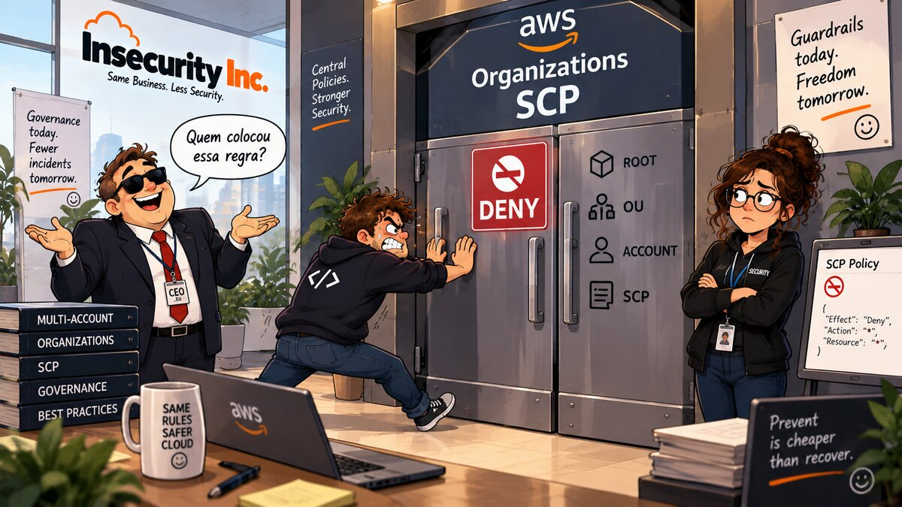

# 14 — 🏛️ Organizations + SCP



**Arco:** Governança (Org)  
**Conceito:** Guardrail do lado da identidade  
**Well-Architected:** [SEC03-BP05](https://docs.aws.amazon.com/wellarchitected/latest/security-pillar/sec_permissions_define_guardrails.html)  
**Custo:** 🟢

## 🎬 Cenário

A Insecurity Inc. cresceu o suficiente para abrir uma segunda conta AWS — um projeto novo, separado do resto, para não misturar billing nem blast radius com a conta original. O time comemora: finalmente vão aplicar tudo que aprenderam nos capítulos 00–13 desde o primeiro dia, em vez de corrigir depois.

Só que a conta nova entra na Organization vazia. Nenhum IAM least privilege (capítulo 01), nenhum MFA enforcement (capítulo 04), nenhum CloudTrail (capítulo 11), nenhum AWS Config (capítulo 12) — nada disso "vem de fábrica" com uma conta nova. Cada lição aprendida nos primeiros 13 capítulos foi uma correção *dentro* de uma conta específica. Não existe nenhum mecanismo que force a próxima conta a herdar nada disso. Se o engenheiro responsável pela conta nova decidir (ou esquecer) de não configurar CloudTrail, ninguém de fora percebe — e ninguém de fora pode impedir.

## 🚨 O Problema

1. **Toda conta-membro nasce com o teto de permissão mais aberto possível.** A SCP padrão da AWS, anexada automaticamente a qualquer conta/OU sem anexação explícita, é a `FullAWSAccess` — `Action: "*"`, `Resource: "*"`, `Effect: Allow`. Isso não é inseguro por si só (é só um teto, não uma concessão — ainda depende do IAM da conta para conceder algo), mas significa que **não existe teto nenhum** até alguém colocar um.
2. **IAM, por definição, só controla a própria conta.** Nenhuma policy, role ou permission boundary dentro da conta nova consegue impedir um administrador *daquela mesma conta* de desabilitar o CloudTrail dela, sair da organização, ou atribuir `AdministratorAccess` para si mesmo (o erro exato do capítulo 01). A decisão de "não fazer isso" fica inteiramente a critério de quem administra a conta — exatamente a lacuna que a conta nova expôs no Cenário.
3. **SEC03-BP05 nomeia esse mecanismo especificamente**: "Define permission guardrails for your organization" — guardrails que operam *fora* da conta, no nível da Organization, e que nenhuma IAM policy local pode contornar. A prática cita Service Control Policies como a ferramenta padrão para isso.
4. **Confirmado ao vivo nesta organização, antes deste capítulo**: `aws organizations list-roots` mostrava `"PolicyTypes": []` no Root — o tipo de policy `SERVICE_CONTROL_POLICY` nem estava habilitado. Não existia nenhuma OU, nenhuma SCP além da `FullAWSAccess` padrão, e a conta nova (`868878695337`, convidada para a organização fora do Terraform — ver Como aplicar) estava direto sob o Root, sem nenhum guardrail organizacional possível de alcançá-la especificamente.

## ✅ A Correção

1. **Habilita `SERVICE_CONTROL_POLICY` no Root da Organization** — pré-requisito manual (CLI/Console), não Terraform; sem isso, anexar uma policy nem é uma operação válida. Ver nota de incidente abaixo sobre por que isso não é um resource Terraform.
2. **Cria uma OU** (`insecurity-inc-workloads`) e move a conta-membro para dentro dela — **não anexa a SCP no Root**. Isso é deliberado: anexar no Root afetaria *toda* conta da organização, inclusive a management account. Anexando na OU, o guardrail alcança só as contas movidas para dentro dela — hoje, a conta nova; no futuro, qualquer conta-membro adicional. A management account continua direto sob o Root, fora do alcance desta SCP.
3. **Cria uma SCP com 4 guardrails**, nenhum dependente de nenhum recurso já existir na conta nova (testável mesmo numa conta recém-criada, sem CloudTrail/Config configurados):
   - `DenyLeaveOrganization` — a conta não pode sair da organização e escapar da governança. É o exemplo mais citado de SCP nos próprios documentos da AWS.
   - `DenyCloudTrailTamper` (`StopLogging`/`DeleteTrail`/`UpdateTrail`) — fecha, no nível da organização, a mesma lacuna que o capítulo 11 fechou numa conta só ("sem CloudTrail, ninguém consegue responder quem apagou X"). Mesmo que a conta nova nunca tenha aplicado o capítulo 11, se algum dia alguém aplicar um trail nela, esta SCP impede que seja desligado por dentro.
   - `DenyConfigTamper` (`StopConfigurationRecorder`/`DeleteConfigurationRecorder`/`DeleteDeliveryChannel`) — mesma lógica, para o capítulo 12.
   - `DenyRootUser` — nega qualquer ação (`Action: "*"`) quando o chamador é o usuário root da conta (`aws:PrincipalArn` terminando em `:root`). Exemplo canônico de SCP na documentação da AWS Organizations.
4. **A SCP é anexada à OU** (`aws_organizations_policy_attachment`), não a uma conta específica — qualquer conta futura movida para `insecurity-inc-workloads` herda os 4 guardrails automaticamente, sem precisar editar a SCP.

### ⚠️ Nota de incidente — por que a Organization é `data`, não `resource`

A primeira versão deste capítulo modelava a Organization como `resource "aws_organizations_organization"`, importado (ela já existia — ver Como aplicar). Isso é um erro de design, não só um detalhe de sintaxe: um `resource` Terraform assume que é dono do ciclo de vida inteiro, incluindo `destroy`. Testado nesta conta — ao rodar o "Como destruir" documentado (mover a conta-membro de volta pro Root, depois `terraform destroy`), o destroy do recurso da Organization chamou `DeleteOrganization` de verdade. A API permite essa chamada quando a organização já foi reduzida a só a management account, sem contas-membro — exatamente o estado que o próprio passo anterior do destroy (mover a conta pra fora da OU) criou. A Organization inteira foi apagada, e o IAM Identity Center (que roda em modo "organization", preso a ela) foi removido junto — invalidando toda sessão SSO em andamento, mesmo as que ainda não tinham expirado pelo próprio relógio do token.

A correção: a Organization é pré-requisito deste capítulo (igual ao convite da conta-membro), não algo que ele cria — então o Terraform aqui nunca deveria ter tido autoridade para destruí-la. Por isso agora é `data "aws_organizations_organization"` (só leitura, sem ação de destroy possível) e "ligar SCP no Root" virou mais um pré-requisito manual, no mesmo nível do convite da conta (ver Como aplicar). O recurso da conta-membro (`aws_organizations_account`) continua importado e gerenciado normalmente — esse é seguro por construção: tem `close_on_deletion = false` por padrão, e testado nesta mesma sessão, o destroy dele chamou `RemoveAccountFromOrganization` (a conta sai da organização e volta a ser standalone), não `CloseAccount` — confirmado logando direto nela depois do destroy (`sts get-caller-identity` funcionando normalmente).

## 💵 Nota de custo

🟢 — Service Control Policies e Organizational Units não têm custo próprio. O único custo real deste arco seria se a conta-membro rodasse recursos pagos dentro dela (fora do escopo deste capítulo, que termina na governança, não nos workloads da conta nova).

## 🧪 Como aplicar

Três caminhos equivalentes. **Dois pré-requisitos comuns aos três, sem equivalente Terraform** (ver Nota de incidente, acima, sobre por que o segundo não é gerenciado pelo Terraform deste capítulo):

```bash
# 1. A conta-membro precisa já estar dentro da Organization -- convite,
#    feito fora deste capítulo.
# Do lado da management account (230650392331):
aws organizations invite-account-to-organization \
  --target Id=868878695337,Type=ACCOUNT
# Do lado da conta convidada (868878695337), usando credenciais dela:
aws organizations accept-handshake --handshake-id <handshake-id-recebido>

# 2. SERVICE_CONTROL_POLICY precisa estar habilitado no Root -- sem isso,
#    anexar qualquer SCP não é uma operação válida.
ROOT_ID=$(aws organizations list-roots --query 'Roots[0].Id' --output text)
[ -n "$ROOT_ID" ] && [ "$ROOT_ID" != None ] || echo "ROOT_ID VAZIA -- não continue sem corrigir (confira o login AWS)"
aws organizations enable-policy-type --root-id "$ROOT_ID" --policy-type SERVICE_CONTROL_POLICY
```

Não existe `aws_organizations_*` resource para o fluxo de convite/handshake no provider Terraform — `aws_organizations_account` só sabe **criar** conta nova (`CreateAccount`), não adotar uma já existente via convite. Por isso a conta aparece como **importada**, não criada, no caminho Terraform abaixo. `enable-policy-type` também fica de fora do Terraform deliberadamente (ver Nota de incidente) — é um atributo de um recurso que representa a Organization inteira, e esta não deve ser algo que o `destroy` deste capítulo possa alcançar.

### 🏗️ Opção 1 — Terraform (caminho testado neste repo)

A conta-membro já existe (não foi criada por este Terraform) — precisa ser importada para o state **antes do primeiro `apply`**. A Organization é só `data` (leitura), não precisa de import:

```bash
terraform init

terraform import aws_organizations_account.member 868878695337

terraform plan   # confira que o plan só muda parent_id e tags -- nada de
                  # ForceNew, nada criando/destruindo a Organization (ela
                  # nem aparece como resource no plan, só como data source)
terraform apply
```

> Troque `868878695337` pelo ID real da sua conta-membro (`aws organizations list-accounts`), e ajuste `member_account_email`/`member_account_name` em `variables.tf` para bater exatamente com os valores reais da sua conta — se não baterem, o Terraform tenta uma `UpdateAccount` ou acha divergência num campo que a API não deixa mudar.

### ⌨️ Opção 2 — AWS CLI

Assume os dois pré-requisitos já feitos (acima), incluindo `$ROOT_ID` já exportado nesta sessão de shell.

```bash
# 1. Cria a OU.
OU_ID=$(aws organizations create-organizational-unit --parent-id "$ROOT_ID" \
  --name insecurity-inc-workloads --query 'OrganizationalUnit.Id' --output text)
[ -n "$OU_ID" ] && [ "$OU_ID" != None ] || echo "OU_ID VAZIA -- não continue sem corrigir"

# 2. Move a conta-membro para dentro da OU.
MEMBER_ACCOUNT_ID="868878695337"
aws organizations move-account --account-id "$MEMBER_ACCOUNT_ID" \
  --source-parent-id "$ROOT_ID" --destination-parent-id "$OU_ID"

# 3. Cria a SCP com os 4 guardrails.
cat > /tmp/insecurity-inc-baseline-guardrails.json <<'EOF'
{
  "Version": "2012-10-17",
  "Statement": [
    {
      "Sid": "DenyLeaveOrganization",
      "Effect": "Deny",
      "Action": "organizations:LeaveOrganization",
      "Resource": "*"
    },
    {
      "Sid": "DenyCloudTrailTamper",
      "Effect": "Deny",
      "Action": ["cloudtrail:StopLogging", "cloudtrail:DeleteTrail", "cloudtrail:UpdateTrail"],
      "Resource": "*"
    },
    {
      "Sid": "DenyConfigTamper",
      "Effect": "Deny",
      "Action": ["config:StopConfigurationRecorder", "config:DeleteConfigurationRecorder", "config:DeleteDeliveryChannel"],
      "Resource": "*"
    },
    {
      "Sid": "DenyRootUser",
      "Effect": "Deny",
      "Action": "*",
      "Resource": "*",
      "Condition": { "StringLike": { "aws:PrincipalArn": "arn:aws:iam::*:root" } }
    }
  ]
}
EOF
POLICY_ID=$(aws organizations create-policy --name insecurity-inc-baseline-guardrails \
  --type SERVICE_CONTROL_POLICY \
  --description "Guardrails mínimos que toda conta-membro da organização herda." \
  --content file:///tmp/insecurity-inc-baseline-guardrails.json \
  --query 'Policy.PolicySummary.Id' --output text)
[ -n "$POLICY_ID" ] && [ "$POLICY_ID" != None ] || echo "POLICY_ID VAZIA -- não continue sem corrigir"

# 4. Anexa a SCP na OU (não no Root).
aws organizations attach-policy --policy-id "$POLICY_ID" --target-id "$OU_ID"
```

### 🖥️ Console (GUI)

1. **AWS Organizations** → **Policies** → **Service control policies** → **Enable service control policies**.
2. **AWS Organizations** → **AWS accounts** → selecione o Root → **Actions** → **Create new** (ou **Organize accounts**) → crie a OU `insecurity-inc-workloads`.
3. Selecione a conta-membro → **Actions** → **Move** → destino: a OU criada no passo 2.
4. **Policies** → **Service control policies** → **Create policy** → cole o mesmo JSON de 4 statements do bloco CLI acima → nome `insecurity-inc-baseline-guardrails`.
5. Abra a policy criada → **Actions** → **Attach policy** → selecione a OU `insecurity-inc-workloads` (não o Root).

## 🧾 Como testar

A SCP é um teto de permissão que vale **mesmo para o usuário root** da conta-membro — por isso, para provar de verdade, é preciso rodar uma chamada de API *dentro* da conta `868878695337`, não na management account. Este teste cria um usuário IAM temporário, só para a prova, direto na conta-membro — mesmo padrão de "recurso temporário fora do Terraform, destruído ao final" do capítulo 13. É deliberadamente mais simples que depender de IAM Identity Center/SSO: essa dependência se mostrou frágil nesta mesma sessão (ver Nota de incidente) e não é necessária para provar a SCP — qualquer credencial dentro da conta-membro, inclusive uma criada agora mesmo, já está sujeita a ela.

Requer uma credencial com permissão de IAM **já existente na conta-membro** (ex.: o root dela, ou outro usuário/role que você já tenha lá) para criar o usuário de teste, e o capítulo aplicado.

```bash
# Rode com uma credencial que já tenha acesso de administrador NA CONTA-MEMBRO
# (não na management account).
TEST_USER="insecurity-inc-14-test"

# 1. Usuário IAM temporário com AdministratorAccess -- só para o teste.
aws iam create-user --user-name "$TEST_USER"
aws iam attach-user-policy --user-name "$TEST_USER" --policy-arn arn:aws:iam::aws:policy/AdministratorAccess
KEYS=$(aws iam create-access-key --user-name "$TEST_USER" --query 'AccessKey.[AccessKeyId,SecretAccessKey]' --output text)
ACCESS_KEY_ID=$(echo "$KEYS" | cut -f1)
SECRET_ACCESS_KEY=$(echo "$KEYS" | cut -f2)
for v in ACCESS_KEY_ID SECRET_ACCESS_KEY; do eval "val=\$$v"; [ -n "$val" ] && [ "$val" != None ] || echo "$v VAZIA -- não continue sem corrigir"; done

# 2. As 3 ações testáveis sem precisar de credencial root:
AWS_ACCESS_KEY_ID="$ACCESS_KEY_ID" AWS_SECRET_ACCESS_KEY="$SECRET_ACCESS_KEY" aws organizations leave-organization
AWS_ACCESS_KEY_ID="$ACCESS_KEY_ID" AWS_SECRET_ACCESS_KEY="$SECRET_ACCESS_KEY" aws cloudtrail stop-logging --name insecurity-inc-ch14-nonexistent-trail
AWS_ACCESS_KEY_ID="$ACCESS_KEY_ID" AWS_SECRET_ACCESS_KEY="$SECRET_ACCESS_KEY" aws configservice stop-configuration-recorder --configuration-recorder-name insecurity-inc-ch14-nonexistent-recorder

# 3. Limpeza -- remove a access key e o usuário de teste.
aws iam delete-access-key --user-name "$TEST_USER" --access-key-id "$ACCESS_KEY_ID"
aws iam detach-user-policy --user-name "$TEST_USER" --policy-arn arn:aws:iam::aws:policy/AdministratorAccess
aws iam delete-user --user-name "$TEST_USER"
```

Resultado real, nesta conta — as três ações negadas antes mesmo de qualquer trail/recorder existir de verdade na conta-membro (a SCP nega na camada de autorização, antes do serviço checar se o recurso existe):

```text
An error occurred (AccessDeniedException) when calling the LeaveOrganization operation:
You don't have permissions to access this resource.

An error occurred (AccessDeniedException) when calling the StopLogging operation:
User: arn:aws:iam::868878695337:user/ayeka-testes
is not authorized to perform: cloudtrail:StopLogging on resource:
arn:aws:cloudtrail:us-east-2:868878695337:trail/insecurity-inc-ch14-nonexistent-trail
with an explicit deny in a service control policy:
arn:aws:organizations::230650392331:policy/o-u56soehvgp/service_control_policy/p-uzx9bd4e

An error occurred (AccessDeniedException) when calling the StopConfigurationRecorder operation:
User: arn:aws:iam::868878695337:user/ayeka-testes
is not authorized to perform: config:StopConfigurationRecorder on resource:
arn:aws:config:us-east-2:868878695337:configuration-recorder/insecurity-inc-ch14-nonexistent-recorder/*
with an explicit deny in a service control policy:
arn:aws:organizations::230650392331:policy/o-u56soehvgp/service_control_policy/p-uzx9bd4e
```

(Testado com um usuário IAM que já existia na conta-membro, equivalente ao usuário temporário descrito acima — mesma lógica, mesmo resultado.)

As mensagens de CloudTrail/Config citam explicitamente a ARN da SCP como a causa — prova direta de que o bloqueio vem da Organization, não de uma permissão faltando no `AdministratorAccess` (que teria permitido as três chamadas, se a SCP não existisse). `LeaveOrganization` devolve uma mensagem genérica da própria API de Organizations, sem citar a SCP por nome, mas o mesmo princípio aplica: `AdministratorAccess` tem `Action: "*"`, então a única fonte possível de negação é o `DenyLeaveOrganization` desta SCP.

**`DenyRootUser` não foi testado ponta a ponta nesta sessão.** Provar esse guardrail especificamente exigiria logar como o usuário root da conta `868878695337` — o que contradiz a escolha deliberada deste teste de evitar credencial root (ver seção acima). A lógica da statement (`aws:PrincipalArn` terminando em `:root`) foi conferida estaticamente (`aws organizations describe-policy`), mas não com uma chamada real como root.

## 📋 Dívidas em aberto

- **`DenyRootUser` sem teste ponta a ponta com root de verdade** — ver Como testar. Quem quiser fechar esse loop precisa logar como root da conta-membro uma única vez, só para esse teste específico.
- **`DenyRootUser` bloqueia *todas* as ações do root, inclusive as poucas que só o root pode fazer** (ex.: fechar a conta, mudar plano de suporte) — trade-off documentado pela própria AWS neste exemplo canônico de SCP; aceito aqui porque nenhuma dessas tarefas é esperada numa conta-membro de laboratório.
- **Só 4 guardrails, não uma baseline completa de Landing Zone.** Não cobre, por exemplo, IMDSv2 obrigatório, regiões permitidas, ou proteção de GuardDuty/Security Hub — escopo deliberadamente pequeno para o capítulo ficar testável e focado.
- **SCP é guardrail do lado da identidade, não do recurso.** Uma credencial de *fora* da organização ainda pode acessar um bucket S3 ou chave KMS da conta-membro se a resource policy permitir — essa lacuna é exatamente o gancho do capítulo 15 (RCP).
- **A fuga do padrão "clonar e rodar isoladamente"**: este capítulo depende de `terraform import` da conta-membro, que já existe fora do Terraform (convidada, não criada por `CreateAccount` — ver Como aplicar) — quem clonar este capítulo em outra conta AWS precisa repetir esse import com o próprio ID antes do primeiro `apply`. É uma limitação real da API do Organizations, não uma escolha de design evitável. A Organization em si não tem mais esse problema (virou `data`, nunca precisou de import).
- **`SERVICE_CONTROL_POLICY` fica habilitado no Root mesmo depois do "Como destruir"**, de propósito — é um pré-requisito de conta inteira (qualquer SCP futura depende disso, inclusive de outro capítulo), não algo que pertença ao ciclo de vida deste capítulo especificamente.
- **"Como destruir" tira a conta-membro da organização** (`RemoveAccountFromOrganization`, via `terraform destroy` do `aws_organizations_account` — ver Como destruir), não só devolve ela pro Root. Testado nesta sessão: a conta volta a ser standalone, do mesmo jeito que estava antes do convite — nada nela é afetado (`sts get-caller-identity` funciona normalmente depois). Quem quiser reaplicar este capítulo de novo precisa convidar a conta de volta (mesmo passo de Como aplicar), não só reimportar.

## 🧹 Como destruir

**Pré-requisito comum aos três caminhos, antes de qualquer destroy**: a conta-membro precisa sair da OU primeiro. A API do Organizations não deixa apagar uma OU que ainda contém uma conta — isso é regra do Organizations, não escolha do Terraform:

```bash
ROOT_ID=$(aws organizations list-roots --query 'Roots[0].Id' --output text)
OU_ID=$(terraform output -raw ou_id 2>/dev/null || aws organizations list-organizational-units-for-parent --parent-id "$ROOT_ID" --query "OrganizationalUnits[?Name=='insecurity-inc-workloads'].Id" --output text)
MEMBER_ACCOUNT_ID="868878695337"
for v in ROOT_ID OU_ID MEMBER_ACCOUNT_ID; do eval "val=\$$v"; [ -n "$val" ] && [ "$val" != None ] || echo "$v VAZIA -- não continue sem corrigir"; done

aws organizations move-account --account-id "$MEMBER_ACCOUNT_ID" \
  --source-parent-id "$OU_ID" --destination-parent-id "$ROOT_ID"
```

### 🏗️ Terraform

```bash
terraform destroy
```

`aws_organizations_account` tem `close_on_deletion = false` por padrão (não declarado neste capítulo, de propósito) — `terraform destroy` **não fecha a conta real** (`CloseAccount`). Testado nesta sessão: ele chama `RemoveAccountFromOrganization` — a conta sai da organização e volta a ser standalone, do mesmo jeito que estava antes do convite documentado em Como aplicar (confirmado logando direto nela depois do destroy: `sts get-caller-identity` funciona normalmente). Se quiser manter a conta na organização, mas fora da OU, aplique o `move-account` de volta pro Root (pré-requisito acima) e rode só `terraform state rm aws_organizations_account.member` antes do `terraform destroy`, em vez de deixar o destroy chegar nesse resource. A Organization em si é só `data` neste capítulo (ver Nota de incidente, em A Correção) — **não há nenhum resource da Organization para o destroy alcançar**; `SERVICE_CONTROL_POLICY` continua habilitado no Root depois do destroy, de propósito (desligar isso não é um passo deste capítulo nem do CLI/Console abaixo — ver Dívidas em aberto).

### ⌨️ AWS CLI

```bash
POLICY_ID=$(aws organizations list-policies --filter SERVICE_CONTROL_POLICY --query "Policies[?Name=='insecurity-inc-baseline-guardrails'].Id" --output text)
[ -n "$POLICY_ID" ] && [ "$POLICY_ID" != None ] || echo "POLICY_ID VAZIA -- não continue sem corrigir"

aws organizations detach-policy --policy-id "$POLICY_ID" --target-id "$OU_ID"
aws organizations delete-policy --policy-id "$POLICY_ID"
aws organizations delete-organizational-unit --organizational-unit-id "$OU_ID"
```

### 🖥️ Console (GUI)

1. **AWS Organizations** → **AWS accounts** → selecione a conta-membro → **Actions** → **Move** → destino: Root (repete o pré-requisito acima, se ainda não tiver feito via CLI).
2. **Policies** → **Service control policies** → `insecurity-inc-baseline-guardrails` → **Detach** da OU → **Delete policy**.
3. **AWS accounts** → selecione a OU `insecurity-inc-workloads` (agora vazia) → **Delete**.

Depois do destroy (de qualquer um dos três caminhos), confira que não sobrou nada:

```bash
aws organizations list-policies --filter SERVICE_CONTROL_POLICY --query "Policies[?Name=='insecurity-inc-baseline-guardrails']" --output text
aws organizations list-organizational-units-for-parent --parent-id "$ROOT_ID" --query "OrganizationalUnits[?Name=='insecurity-inc-workloads']" --output text
# Esperado: as duas saídas vazias

aws organizations list-accounts --query "Accounts[?Id=='868878695337'].{Status:Status,Path:Paths[0]}" --output table
# Esperado: Status ACTIVE, Path de volta em .../$ROOT_ID/868878695337/ (sem OU no meio)
```

## 📚 Referências

- [SEC03-BP05 — Define permission guardrails for your organization](https://docs.aws.amazon.com/wellarchitected/latest/security-pillar/sec_permissions_define_guardrails.html) — AWS Well-Architected Framework, Security Pillar; base deste capítulo.
- [Service control policies (SCPs)](https://docs.aws.amazon.com/organizations/latest/userguide/orgs_manage_policies_scps.html) — AWS Organizations User Guide; conceito de teto de permissão, FullAWSAccess como default, SCP não se aplica à management account por padrão a menos que anexada no Root.
- [SCP example: Deny access to AWS based on the requested AWS Region / Restrict access to the root user](https://docs.aws.amazon.com/organizations/latest/userguide/orgs_manage_policies_scps_examples.html) — exemplos oficiais; base do `DenyRootUser` e `DenyLeaveOrganization` deste capítulo.
- [Enabling and disabling a policy type](https://docs.aws.amazon.com/organizations/latest/userguide/orgs_manage_policies_enable-disable.html) — por que `SERVICE_CONTROL_POLICY` precisa ser habilitado explicitamente no Root antes de qualquer SCP funcionar.
- [Inviting an AWS account to join your organization](https://docs.aws.amazon.com/organizations/latest/userguide/orgs_manage_accounts_invites.html) — fluxo de convite/handshake usado para trazer a conta-membro para dentro da organização (sem equivalente Terraform — ver Como aplicar).
- [Deleting an organization](https://docs.aws.amazon.com/organizations/latest/userguide/orgs_manage_org_delete.html) — `DeleteOrganization` só é permitida quando a organização não tem nenhuma conta-membro, só a management account; base da Nota de incidente (em A Correção) sobre por que a Organization é `data`, não `resource`, neste capítulo.
- [IAM Identity Center prerequisites](https://docs.aws.amazon.com/singlesignon/latest/userguide/prereqs.html) — a instância "organization" do Identity Center depende de existir uma AWS Organization; confirma, nesta documentação, o mecanismo por trás do Identity Center ter sido removido junto quando a Organization foi apagada (mesma Nota de incidente).
- Terraform AWS provider: [`aws_organizations_organization` (data source)](https://registry.terraform.io/providers/hashicorp/aws/latest/docs/data-sources/organizations_organization), [`aws_organizations_organizational_unit`](https://registry.terraform.io/providers/hashicorp/aws/latest/docs/resources/organizations_organizational_unit), [`aws_organizations_account`](https://registry.terraform.io/providers/hashicorp/aws/latest/docs/resources/organizations_account), [`aws_organizations_policy`](https://registry.terraform.io/providers/hashicorp/aws/latest/docs/resources/organizations_policy), [`aws_organizations_policy_attachment`](https://registry.terraform.io/providers/hashicorp/aws/latest/docs/resources/organizations_policy_attachment).
- Capítulo [11](../11-cloudtrail/README.md) — origem da lacuna que `DenyCloudTrailTamper` fecha no nível da organização.
- Capítulo [12](../12-aws-config/README.md) — origem da lacuna que `DenyConfigTamper` fecha no nível da organização.
- Capítulo [15](../15-organizations-rcp/README.md) — o guardrail do lado do recurso que complementa este, feito do lado da identidade (ver Dívidas em aberto).
