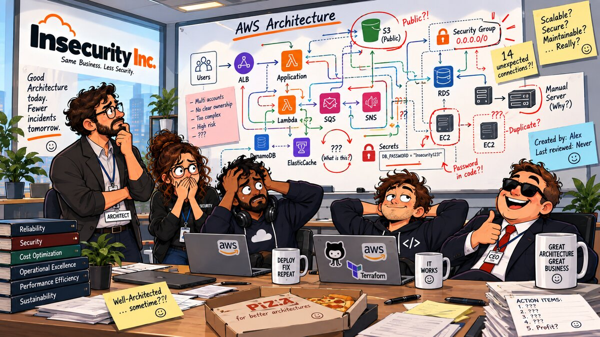

# 16 — 🏁 Well-Architected Review



**Arco:** Fechamento  
**Conceito:** Auditoria final  
**Well-Architected:** [Security Pillar](https://docs.aws.amazon.com/wellarchitected/latest/security-pillar/welcome.html) (revisão completa via [AWS Well-Architected Tool](https://aws.amazon.com/well-architected-tool/))  
**Custo:** 🟢  
**Depende de:** capítulo(s) todos anteriores (revisa o desenho deles; nenhum precisa estar aplicado)

## 🎬 Cenário

Quinze capítulos depois, o CEO da Insecurity Inc. está tranquilo: cada capítulo corrigiu um erro e cita uma best practice do Well-Architected no cabeçalho. Alguém fez a conta no [mapeamento do repositório](../docs/well-architected-mapping.md): 15 das 63 práticas do pilar de segurança citadas. "Estamos cobertos."

Um cliente enterprise manda o questionário de segurança antes de assinar contrato. A primeira pergunta não é sobre bucket, chave ou security group. É "quando foi a última revisão formal da sua arquitetura e quais riscos altos ela deixou em aberto?". A resposta honesta está na lousa da sala: *Last reviewed: Never*. A lista de action items é `???`.

No dia da revisão aparece um segundo problema. A conta está vazia: cada capítulo foi destruído ao final, por custo. Não há CloudTrail, Config nem Access Analyzer de pé. O que sobrou é justamente o que nenhum capítulo gerencia: o usuário IAM de quem roda o Terraform, com access key de admin de cinco meses e sem MFA. O capítulo 04 dedicou um README inteiro a proibir isso.

## 🚨 O Problema

1. **Cada correção foi validada sozinha, nunca o conjunto.** O capítulo 05 cifrou um bucket. O capítulo 06 trocou a chave desse bucket por uma CMK. Nenhum capítulo olhou os quatro volumes EBS que os capítulos 01 e 02 criaram, e todos nasceram sem criptografia (`encrypted = false` no state). Não é falha de nenhum capítulo isolado: o assunto simplesmente não era de nenhum deles.
2. **Citar uma prática não é atender a prática.** O mapeamento contava citações no cabeçalho, e uma citação mede intenção. O capítulo 13 cita SEC04-BP03 e, nas próprias Dívidas em aberto, admite que não a implementa por completo. O mapeamento atribuía SEC04-BP04 ao capítulo 12, que nas Dívidas diz "sem remediação automática" e no cabeçalho cita outra prática (SEC01-BP03). A revisão abaixo chega a 16 práticas atendidas, número quase igual às 15 citadas. Só que, contra o mapeamento como estava, **apenas 11 aparecem nas duas listas**.
3. **O que nenhum capítulo gerencia fica de fora sem ninguém perceber.** Os capítulos tratam de recursos. Nenhum trata da conta onde eles rodam: password policy, criptografia EBS por padrão, Block Public Access no nível da conta, contatos de segurança, IAM Identity Center, as credenciais de quem opera. Essas configurações não aparecem em nenhum `terraform plan`.
4. **Sem revisão registrada, não existe linha de base.** O próprio framework descreve a revisão como [processo contínuo](https://docs.aws.amazon.com/wellarchitected/latest/framework/the-review-process.html), não auditoria única: você registra o estado, prioriza os riscos altos, corrige e revisa de novo. A Well-Architected Tool guarda essa linha de base como *milestone*. Sem ela, "estamos melhores do que antes?" não tem resposta.

## ✅ A Correção

A correção é a revisão em si, feita de um jeito que dê para repetir.

1. **Um workload na AWS Well-Architected Tool** (`insecurity-inc-security-review`), com a lente oficial `wellarchitected` (versão `2025-02-25`, a vigente na data da revisão), ambiente `PREPRODUCTION`, região `us-east-1`. Só o pilar de **Segurança** é respondido: 11 perguntas, 63 práticas.
2. **Escopo explícito: o que conta como "existe".**
   - **Recursos dos capítulos 00–15 contam como aplicados ao mesmo tempo.** Eles estão destruídos por regra de custo do projeto, não por descuido. A revisão avalia o desenho que o repositório entrega, não uma conta vazia.
   - **Configuração de conta que nenhum capítulo gerencia vale como está**, conferida ao vivo em 2026-10-09 (ver Achados ao vivo).
3. **Critério para marcar uma prática: algum capítulo implementa *e testa* o núcleo dela.** A Well-Architected Tool só tem "selecionado" ou "não selecionado", sem meio-termo. Implementação parcial vira nota, não checkbox. Citação no cabeçalho, sozinha, não conta.
4. **"None of these" em vez de "Not applicable" para compute (SEC06) e appsec (SEC11).** Marcar como não aplicável tiraria as duas perguntas do cálculo de risco. Só que o checkout da Insecurity Inc. tem compute e tem código: a Lambda de rotação do capítulo 08 é código próprio rodando na conta. O repositório é que ainda não chegou lá. Usar N/A para esconder uma lacuna é o mesmo erro do `0.0.0.0/0` "só até resolver" do capítulo 09.
5. **As respostas são código.** Cada pergunta, as práticas marcadas e a justificativa ficam versionadas em [answers.json](./answers.json). O caminho CLI aplica esse arquivo no workload. A próxima revisão vira um `git diff`, não uma releitura do zero.

## 📊 Resultado

Veredito da Well-Architected Tool (`get-lens-review`, pilar de segurança): **9 perguntas com risco alto, 2 com risco médio, nenhuma sem risco.** São 16 das 63 práticas atendidas.

| Pergunta | Risco | Atende | Maior lacuna |
| --- | --- | --- | --- |
| SEC01 — operar com segurança | 🔴 Alto | 4/8 — BP02, BP03, BP05, BP06 | **BP01**: os capítulos 00–13 rodaram na management account |
| SEC02 — identidades | 🔴 Alto | 2/6 — BP03, BP06 | **BP01/BP02**: quem opera as contas usa access key estática de admin, sem MFA |
| SEC03 — permissões | 🟠 Médio | 5/9 — BP01, BP02, BP05, BP07, BP09 | BP03: nenhum acesso de emergência (*break-glass*) |
| SEC04 — detecção | 🟠 Médio | 1/4 — BP01 | BP04: o Config detecta e o EventBridge avisa, mas ninguém remedia |
| SEC05 — rede | 🔴 Alto | 1/4 — BP02 | **BP01**: uma subnet só, sem camadas pública/privada |
| SEC06 — compute | 🔴 Alto | 0/5 | **BP01/BP02**: nenhuma gestão de vulnerabilidade nem imagem *hardened* |
| SEC07 — classificação de dados | 🔴 Alto | 0/4 | **BP01**: nenhum esquema de classificação |
| SEC08 — dados em repouso | 🔴 Alto | 2/4 — BP01, BP04 | **BP02**: volumes EBS sem criptografia; criptografia EBS por padrão desligada |
| SEC09 — dados em trânsito | 🔴 Alto | 1/3 — BP02 | **BP01**: a camada web aceita 443, mas não existe certificado gerenciado |
| SEC10 — resposta a incidente | 🔴 Alto | 0/8 | **BP01/BP02**: ninguém designado, nenhum plano |
| SEC11 — appsec | 🔴 Alto | 0/8 | **BP06/BP07**: deploy é `terraform apply` do notebook, sem pipeline |

Em negrito, as lacunas que a própria AWS classifica como risco **alto** ("Level of risk exposed if this best practice is not established: High", na página de cada prática). Nas duas perguntas de risco médio, todas as práticas que faltam têm risco médio ou baixo. A justificativa de cada marcação, prática por prática, está em [answers.json](./answers.json).

### Citado × atendido

Comparação com o [mapeamento](../docs/well-architected-mapping.md) **como ele estava antes desta revisão**. Um dos desencontros era erro do próprio mapeamento: ele atribuía SEC04-BP04 ao capítulo 12, cujo cabeçalho cita SEC01-BP03. O mapeamento foi corrigido junto com este capítulo e hoje mostra 12 práticas em comum com a revisão.

| | Práticas |
| --- | --- |
| Citadas no mapeamento **e** atendidas (11) | SEC02-BP03, SEC02-BP06, SEC03-BP02, SEC03-BP05, SEC03-BP07, SEC03-BP09, SEC04-BP01, SEC05-BP02, SEC08-BP01, SEC08-BP04, SEC09-BP02 |
| Citadas, mas **não** atendidas (4) | **SEC02-BP01**: a Force MFA do capítulo 04 cobre só o grupo de exemplo, não quem opera a conta. **SEC04-BP03**: o capítulo 13 captura uma fonte, não correlaciona. **SEC04-BP04**: nenhuma remediação definida. **SEC08-BP02**: "exigir" criptografia em repouso não convive com volume EBS sem criptografia |
| Atendidas, mas **não** citadas (5) | **SEC01-BP02**: root com MFA e sem chave, configurado à mão, fora do repositório. **SEC01-BP03**: citada no cabeçalho do capítulo 12, o mapeamento estava desatualizado. **SEC01-BP05** e **SEC01-BP06**: serviços gerenciados e tudo em IaC, práticas transversais que nenhum capítulo reivindicava. **SEC03-BP01**: cada capítulo começa definindo o que a função precisa acessar |

### Achados ao vivo

Estado real das duas contas em 2026-10-09, fora de qualquer capítulo:

| Item | Management (`230650392331`) | Membro (`868878695337`) | Prática |
| --- | --- | --- | --- |
| MFA do root | ✅ ligado | ✅ ligado | SEC01-BP02 |
| Access key do root | ✅ nenhuma | ✅ nenhuma | SEC01-BP02 |
| Contatos alternativos (security, billing, operations) | ❌ nenhum | ❌ nenhum | SEC01-BP02 |
| Usuários IAM de operação | ❌ 1 usuário no grupo `admin`, access key ativa há 5 meses, sem MFA | ❌ 2 usuários, access keys ativas há 2 e 7 meses, sem MFA | SEC02-BP01/02/05 |
| Password policy | ❌ inexistente | ❌ inexistente | SEC02-BP01 |
| IAM Identity Center | ❌ inexistente (removido no incidente do capítulo 14) | — | SEC02-BP04 |
| Block Public Access do S3, nível de conta | ❌ desligado | ❌ desligado | SEC08-BP04 |
| Criptografia EBS por padrão (`us-east-1`) | ❌ desligada | ❌ desligada | SEC08-BP02 |
| CloudTrail, Config, Access Analyzer | ⏸ nenhum (destruídos por custo) | ⏸ nenhum | SEC04 (contados como ligados, ver Correção, ponto 2) |
| GuardDuty, Security Hub | ❌ não habilitados (nenhum capítulo os cria) | ❌ não habilitados | SEC04-BP02 |

O caso mais irônico é o dos usuários de operação. Se a `insecurity-inc-force-mfa-policy` do capítulo 04 fosse anexada ao grupo `admin`, quem roda o Terraform perderia o acesso a quase tudo na hora. Sem MFA na sessão, a policy nega toda ação exceto configurar o próprio dispositivo MFA, e uma access key crua nunca carrega MFA (`BoolIfExists` trata a ausência da chave como `false`).

## 🧭 Plano de melhoria

A revisão só tem valor se virar fila de trabalho. Abaixo estão as lacunas de risco alto e os achados ao vivo que enfraquecem práticas já marcadas, separados pelo custo de resolver:

**Configuração de conta, grátis, sem capítulo novo.** É a mesma categoria do default SG da VPC padrão no capítulo 09, uma decisão de conta e não de laboratório. Por isso este capítulo não aplica nada disso, só registra:

| Ação | Prática | Comando de referência |
| --- | --- | --- |
| Recriar o IAM Identity Center, migrar a operação para SSO e desativar as access keys | SEC02-BP01/02/04/05 | Console (Identity Center) + `aws iam update-access-key --status Inactive` |
| Password policy nas duas contas | SEC02-BP01 | `aws iam update-account-password-policy` |
| Criptografia EBS por padrão, em cada região usada | SEC08-BP02 | `aws ec2 enable-ebs-encryption-by-default` |
| Block Public Access no nível da conta | SEC08-BP04 | `aws s3control put-public-access-block --account-id ...` |
| Contato alternativo de segurança | SEC01-BP02, SEC10-BP01 | `aws account put-alternate-contact --alternate-contact-type SECURITY` |

**Precisa de capítulo próprio** (gancho da próxima temporada):

- **SEC01-BP01**: tirar os workloads da management account. A organização dos capítulos 14/15 já existe, falta mover o trabalho para dentro dela.
- **SEC11-BP06/07 + SEC02-BP02 de uma vez**: um pipeline de deploy (por exemplo, GitHub Actions assumindo uma role via OIDC) elimina a access key estática de quem roda o Terraform, faz o deploy por automação e abre espaço para scan de IaC antes do `apply`.
- **SEC05-BP01**: VPC em camadas, subnet pública e privada (dívida do capítulo 09).
- **SEC07-BP01/02/04**: esquema de classificação e ciclo de vida do dado. Os recibos dos capítulos 05/06 são o candidato natural.
- **SEC09-BP01**: certificado gerenciado (ACM) para a camada web.
- **SEC10-BP01/02**: plano de resposta a incidente. O incidente real do capítulo 14 já mostrou que ele faz falta.
- **SEC06-BP01/02**: gestão de vulnerabilidade e imagem *hardened*, quando o checkout ganhar compute de verdade.
- **SEC01-BP04/07**: threat model e acompanhamento de ameaças. São processo, sem recurso AWS para ancorar um capítulo, mas de risco alto.

A próxima revisão roda depois dessa leva, sobre o mesmo `answers.json`, e grava um segundo milestone para comparar com este.

## 💵 Nota de custo

🟢 — a AWS Well-Architected Tool [não cobra](https://aws.amazon.com/well-architected-tool/) por workload, revisão, milestone nem relatório. Nenhum outro recurso é criado.

## 🧪 Como aplicar

A "aplicação" deste capítulo é registrar a revisão na Well-Architected Tool. Os caminhos CLI e Console são equivalentes, mas aqui o **caminho testado é o CLI**: o Terraform não tem como fazer isso (ver abaixo).

### 🏗️ Opção 1 — Terraform

Sem equivalente. O provider `hashicorp/aws` não tem nenhum recurso nem data source da Well-Architected Tool: conferido no schema da versão 5.100.0, a que os capítulos deste repositório usam (`terraform providers schema -json`, 1526 recursos, nenhum `wellarchitected`). Por isso este capítulo não tem `main.tf`, como o `CLAUDE.md` já previa.

### ⌨️ Opção 2 — AWS CLI (caminho testado neste capítulo)

Requer `jq` e credencial de qualquer conta. A revisão foi registrada na management account, que é onde os capítulos 00–13 rodaram. Rode de dentro da pasta `16-well-architected-review/`, porque o bloco lê o `answers.json` do diretório atual.

```bash
[ -f answers.json ] || echo "answers.json NÃO ENCONTRADO -- rode de dentro da pasta 16-well-architected-review"

WID=$(aws wellarchitected create-workload \
  --workload-name insecurity-inc-security-review \
  --description "Revisao do pilar de seguranca sobre os capitulos 00-15 do Insecurity Inc." \
  --environment PREPRODUCTION \
  --lenses wellarchitected \
  --aws-regions us-east-1 \
  --review-owner "Insecurity Inc. (lab)" \
  --tags project=insecurity-inc,env=lab,chapter=16 \
  --query WorkloadId --output text)
[ -n "$WID" ] && [ "$WID" != None ] || echo "WID VAZIA -- não continue sem corrigir (confira o login AWS; se o erro foi ConflictException, o workload já existe -- veja Como destruir)"

# Uma chamada por pergunta: as práticas marcadas e a nota saem do answers.json.
for q in $(jq -r 'keys[]' answers.json); do
  jq --arg w "$WID" --arg q "$q" \
    '{WorkloadId: $w, LensAlias: "wellarchitected", QuestionId: $q, SelectedChoices: .[$q].selected, Notes: .[$q].notes}' \
    answers.json > /tmp/insecurity-inc-16-answer.json
  aws wellarchitected update-answer --cli-input-json file:///tmp/insecurity-inc-16-answer.json \
    --query 'Answer.[QuestionId,Risk]' --output text
done
rm -f /tmp/insecurity-inc-16-answer.json

# Linha de base para a próxima revisão.
aws wellarchitected create-milestone --workload-id "$WID" --milestone-name "S01E16 - primeira revisao"
```

O `--cli-input-json` evita montar a lista de `--selected-choices` com expansão de variável, que se comporta diferente em bash e zsh. As notas têm acento sem problema (testado), mas nome e descrição do workload ficaram sem acento por cautela.

### 🖥️ Console (GUI)

1. **AWS Well-Architected Tool** → **Workloads** → **Define workload**. Nome `insecurity-inc-security-review`, a mesma descrição e o mesmo *review owner* do bloco CLI, **Environment** `Pre-production`, **Regions** `US East (N. Virginia)`, tags `project=insecurity-inc`, `env=lab`, `chapter=16`. Na etapa de lentes, mantenha só **AWS Well-Architected Framework** → **Define workload**.
2. No workload → **Start reviewing** → **AWS Well-Architected Framework** → pilar **Security**.
3. Para cada uma das 11 perguntas, marque as práticas listadas em `selected` no [answers.json](./answers.json) (o título de cada uma está na tabela de Resultado) e cole o campo `notes` em **Notes**. Em SEC06, SEC07, SEC10 e SEC11, marque **None of these**, não **Question does not apply to this workload** (ver Correção, ponto 4).
4. **Save and exit** → no painel do workload, **Save milestone** → nome `S01E16 - primeira revisao`.
5. Opcional: **Generate report** baixa o mesmo PDF do Como testar.

## 🧾 Como testar

Se estiver numa sessão de shell nova, recupere o ID do workload pelo nome:

```bash
WID=$(aws wellarchitected list-workloads --workload-name-prefix insecurity-inc-security-review \
  --query 'WorkloadSummaries[0].WorkloadId' --output text)
[ -n "$WID" ] && [ "$WID" != None ] || echo "WID VAZIA -- não continue sem corrigir (o workload não existe nesta conta/região, ou o login AWS expirou)"

# 1. Veredito do pilar:
aws wellarchitected get-lens-review --workload-id "$WID" --lens-alias wellarchitected \
  --query "LensReview.PillarReviewSummaries[?PillarId=='security'].RiskCounts" --output json

# 2. Risco e número de opções marcadas por pergunta (o --max-results é obrigatório, ver abaixo):
aws wellarchitected list-answers --workload-id "$WID" --lens-alias wellarchitected --pillar-id security \
  --max-results 50 --query 'AnswerSummaries[].[QuestionId,Risk,length(SelectedChoices)]' --output text

# 3. Milestone gravado:
aws wellarchitected list-milestones --workload-id "$WID" \
  --query 'MilestoneSummaries[].[MilestoneNumber,MilestoneName]' --output text

# 4. Relatório PDF (todos os pilares; só Segurança respondido):
aws wellarchitected get-lens-review-report --workload-id "$WID" --lens-alias wellarchitected \
  --query 'LensReviewReport.Base64String' --output text | base64 --decode > /tmp/insecurity-inc-16-report.pdf
file /tmp/insecurity-inc-16-report.pdf
```

Resultado real, nesta conta:

```text
[
    {
        "UNANSWERED": 0,
        "HIGH": 9,
        "MEDIUM": 2,
        "NONE": 0,
        "NOT_APPLICABLE": 0
    }
]
securely-operate        HIGH    4
identities      HIGH    2
permissions     MEDIUM  5
detect-investigate-events       MEDIUM  1
network-protection      HIGH    1
protect-compute HIGH    1
data-classification     HIGH    1
protect-data-rest       HIGH    2
protect-data-transit    HIGH    1
incident-response       HIGH    1
application-security    HIGH    1
1       S01E16 - primeira revisao
/tmp/insecurity-inc-16-report.pdf: PDF document, version 1.7, 80 page(s)
```

Como ler esse resultado:

- **`HIGH: 9`, `MEDIUM: 2`, `NONE: 0`** é o veredito da tabela de Resultado, calculado pela própria Well-Architected Tool a partir das práticas marcadas, não por este README.
- **Nenhuma pergunta ficou `UNANSWERED` nem `NOT_APPLICABLE`.** Em SEC06, SEC07, SEC10 e SEC11, a única opção marcada é o "None of these", que conta como resposta e gera risco alto.
- **Pegadinha vivida: sem `--max-results 50`, a lista para em 10 perguntas, sem aviso.** A AWS CLI não pagina o `list-answers` sozinha, ao contrário de outros `list-*`. A primeira página traz 10 itens e um `NextToken`, e com `--query ... --output text` esse token nem aparece. A 11ª pergunta (`application-security`) simplesmente some da saída. Para o pilar de segurança, 50 (o máximo da API) cobre tudo numa página.
- **O risco de cada pergunta acompanha a prática mais grave que ficou de fora**, pelo menos nesta revisão: SEC03 e SEC04 não deixaram de fora nenhuma prática de risco alto e ficaram `MEDIUM`; as outras nove deixaram e ficaram `HIGH`.

## 📋 Dívidas em aberto

- **Autoavaliação, não revisão independente.** Quem escreveu os capítulos é quem julga os capítulos. Por isso cada marcação tem justificativa em `answers.json` e o critério é explícito (Correção, ponto 3). Mesmo assim, o certo numa empresa real é ter alguém de fora do time conduzindo a revisão.
- **Só o pilar de Segurança.** Os outros cinco pilares aparecem como não respondidos no relatório. Este repositório é sobre segurança, e o restante fica de fora de propósito.
- **Checkbox binário esconde parcialidade.** SEC03-BP02 está marcada, mas o operador humano é admin. SEC04-BP01 está marcada, mas sem *data events* e com retenção de 1 dia. A nota de cada pergunta registra a ressalva. O número de risco, não.
- **Escopo híbrido.** Desenho dos capítulos mais estado real das contas foi uma escolha. Uma revisão da conta "como está hoje", com tudo destruído, daria um resultado pior: SEC04 inteira sem atender.
- **Os achados ao vivo não são corrigidos aqui.** Configuração de conta fica fora do ciclo de vida de um laboratório (mesmo raciocínio do default SG no capítulo 09). Eles estão no Plano de melhoria, não num `apply`.
- **A lente está fixada na versão `2025-02-25`.** Quando a AWS publicar uma versão nova, o workload mostra um aviso de upgrade (`upgrade-lens-review`), e IDs de prática podem mudar. O `answers.json` precisaria ser conferido de novo contra a lente nova. Um ID que não existe mais faz o `update-answer` daquela pergunta falhar com `ValidationException`, sem afetar as outras: confira a saída do loop, que deve listar as 11 perguntas.
- **O milestone some no Como destruir.** A Well-Architected Tool é grátis e o workload poderia ficar, mas o projeto destrói tudo ao final de cada capítulo. A linha de base que sobrevive é o `answers.json` versionado no git, não o milestone.

## 🧹 Como destruir

### 🏗️ Terraform

Nada a destruir: este capítulo não tem Terraform.

### ⌨️ AWS CLI

```bash
WID=$(aws wellarchitected list-workloads --workload-name-prefix insecurity-inc-security-review \
  --query 'WorkloadSummaries[0].WorkloadId' --output text)
[ -n "$WID" ] && [ "$WID" != None ] || echo "WID VAZIA -- nada a apagar, ou o login AWS expirou"

aws wellarchitected delete-workload --workload-id "$WID"
```

Apagar o workload apaga junto as respostas e os milestones.

### 🖥️ Console (GUI)

1. **AWS Well-Architected Tool** → **Workloads** → selecione `insecurity-inc-security-review` → **Delete** → confirme.

Depois de qualquer um dos caminhos, confira:

```bash
aws wellarchitected list-workloads --workload-name-prefix insecurity-inc-security-review \
  --query 'WorkloadSummaries[].WorkloadName' --output text
# Esperado: saída vazia
```

## 📚 Referências

- [AWS Well-Architected Framework — Security Pillar](https://docs.aws.amazon.com/wellarchitected/latest/security-pillar/welcome.html) — as 11 perguntas e 63 práticas; o nível de risco de cada prática está na página dela.
- [The review process](https://docs.aws.amazon.com/wellarchitected/latest/framework/the-review-process.html) — AWS Well-Architected Framework; revisão como processo contínuo, não auditoria única.
- [AWS Well-Architected Tool User Guide](https://docs.aws.amazon.com/wellarchitected/latest/userguide/intro.html) — workloads, lentes, milestones, relatórios.
- [AWS CLI — `wellarchitected`](https://docs.aws.amazon.com/cli/latest/reference/wellarchitected/) — `create-workload`, `update-answer`, `get-lens-review`, `create-milestone`, `get-lens-review-report`, `delete-workload`.
- [docs/well-architected-mapping.md](../docs/well-architected-mapping.md) — o mapeamento por citação que esta revisão confronta (atualizado neste capítulo).
- [answers.json](./answers.json) — as respostas desta revisão, prática por prática.
- Capítulo [04](../04-mfa-enforcement/README.md) — a Force MFA que os operadores das contas não seguem.
- Capítulo [09](../09-security-groups/README.md) — o precedente de "decisão de conta, não de laboratório" (default SG da VPC padrão).
- Capítulo [14](../14-organizations-scp/README.md) — a Nota de incidente, o mais perto de um post-mortem que o repositório tem (SEC10-BP08).
